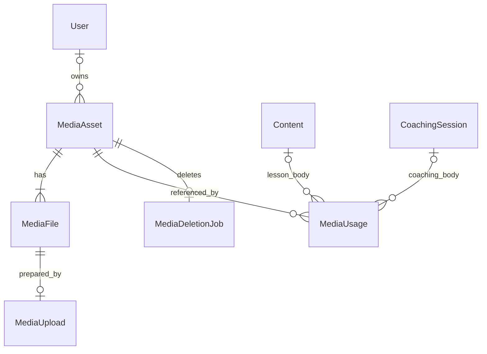

# 개발 정책 2 — 미디어 자산 데이터와 복구 절차

- 작성: 2026-10-05 / 전면 정리: 2026-10-07
- 대상: 개발·운영. 아래 SQL은 검증용 설계 기준이며 운영 migration이 아니다.
- 상품·경로 계약: [개발 정책 1 — 보관 경로와 수명](./media-r2-folder-structure.md)
- 의사결정: [코칭·코스 미디어 보관 정책](./media-library-decision.md)
- 기존 모델: `User`, `Content`, `Lesson`, `Module`, `Course`, `CoachingSession`, `AuditLog`, `IdempotencyKey`
- 구현 기록: 12–19절은 각 단계 당시의 결과다. 현재 구현·검증·미완료 범위는 **19절**을 따른다. 운영 미배포이며 자동 삭제는 비활성이다.

## 1. 설계 기준과 이번 개정

안전성은 즉시 지키고 물리 정리는 재시도로 수렴시킨다. DB 커밋과 R2 작업을 하나의 트랜잭션으로 설명하지 않는다. 문서의 완료 표시는 의미를 고정하며 저장소에 향후 어떤 쓰기도 도착하지 않는다는 증명으로 사용하지 않는다.

| 반드시 유지할 조건 | 보장 위치 |
|---|---|
| 사용처가 있거나 보관 중이면 자산 삭제 금지 | 자산 잠금, 사용처 저장 절차, DB 삭제 진입 검사 |
| 미검증 파일·폐기한 작업은 공개 금지 | 파일 검증 정보, 작업 상태, 최종 확정 트랜잭션, 재생 권한 |
| 최종 key와 그 내용은 불변 | DB 불변 필드, 검증 결과 고정, R2 조건부 생성 |
| 본문과 사용처는 함께 저장 | 콘텐츠 잠금과 같은 DB 트랜잭션 |
| 늦은 worker는 DB에 결과 확정 불가 | 작업별 leaseToken 검사, 영향 행 0이면 전체 롤백 |
| 중단·성공 후 잔여 객체도 언젠가 정리 | staging 수명 규칙, DB의 영구 보존 이력, 주기적 대조 |

테이블은 다섯 개를 유지한다. 원본 업로드와 파생본 준비의 실행 기록을 **`MediaUpload` 하나로 통합**하고, `MediaFile`에는 파일 식별·검증·정리 관측만 둔다. `MediaFile`과 `MediaUpload` 양쪽에 쓰기 상태를 중복 저장하지 않는다.

이전 안의 `writeState`, `writeToken`, `writeLeaseExpiresAt`, `cleanedAt`, `settledAt`, `settleNotBefore`는 사용하지 않는다. 원래 프로세스가 살아 돌아와 `STOPPED`를 남길 때까지 기다리지 않는다. 작업 폐기는 공개 자격을 취소하고, 바이트 삭제는 별도 관측·재시도 대상이다. 실제 구현된 테이블의 컬럼을 이 문서만으로 삭제하라는 뜻은 아니다. 다섯 모델을 코드에 반영한 범위와 DB 배포 여부는 12절에서 구분한다.

## 2. 관계와 필드의 정본



| 테이블 | 담당하는 사실 | 중복해서 저장하지 않는 것 |
|---|---|---|
| `MediaAsset` | 공통/개인/분류 대기, 소유, 보관 의사, 공개 생명주기 | 파일 용량·파일별 쓰기 작업 |
| `MediaFile` | 최종 key 하나, 역할, 고정한 검증 결과, 현재 파생본, 삭제 관측 | 사용처 수 캐시·클라이언트 쓰기 종료 여부 |
| `MediaUsage` | 콘텐츠와 자산의 연결 | courseId·콘텐츠 권한 사본 |
| `MediaUpload` | 파일 하나를 준비하는 작업, staging key, 검증/최종 저장/재시도 | 중복 assetId. fileId를 통해 자산을 찾는다 |
| `MediaDeletionJob` | 자산의 첫 삭제 수행과 재시도 | 영구적으로 바이트가 없다는 증명 |

원본은 자산당 정확히 한 파일 row다. 파생본은 역할별 여러 버전을 둘 수 있다. 원본 재업로드는 새 자산, 파생본 재생성은 새 파일과 새 준비 작업을 만든다. 같은 준비 작업의 HTTP 재시도는 같은 기록을 반환한다. CANONICAL의 모든 파일과 새 파생본은 준비 작업이 반드시 하나 있어야 한다. LEGACY 원본을 기존 위치에서 검증·등록할 때만 준비 작업 없이 등록할 수 있다.

코스 사용처는 `Content → Lesson → Module → Course`로 찾는다. 코칭은 `CoachingSession`을 직접 가리킨다. 같은 본문 안에 같은 자산이 여러 번 있어도 사용처는 하나이며 `occurrenceCount`만 달라진다.

필드명은 코드에서 camelCase, 아래 SQL에서는 snake_case이며 Prisma `@map`으로 맞춘다. CUID는 PostgreSQL `text`다. bigint 용량은 API에서 문자열로 직렬화한다.

## 3. 상태 전이와 완료의 의미

### 자산

| 보관 상태 / storageStatus | 의미 | 허용되는 다음 동작 |
|---|---|---|
| ACTIVE / PENDING | 원본 준비 중. 공개되지 않음 | READY 또는 ABANDONED |
| ACTIVE / READY | 보관함에서 사용 가능 | 휴지통 이동 |
| ACTIVE / ABANDONED | 원본 준비를 포기한 이력. 보관함에 나오지 않음 | 잔여 객체 정리만. 재활성화 금지 |
| TRASHED / READY | 새 삽입 금지, 기존 콘텐츠는 재생 | 복원 또는 삭제 선점 |
| TRASHED / DELETING | 공개·복원 금지, 최종 파일들 정리 중 | DELETED |
| TRASHED / DELETED | 서비스에서 삭제 확정. 알려진 최종 key들의 부재를 확인했음 | 이력 유지·잔여 객체 재점검 |

`scope = UNCLASSIFIED`는 위 상태와 독립적인 분류다. LEGACY에만 쓰며 일반 선택·미리보기·자동 삭제를 금지한다. 관리자가 한 번 SHARED 또는 PERSONAL로 분류할 수 있다. 분류 후 소유와 key를 바꾸지 않는다.

### 파일과 준비 작업

| 대상 | 전이 | 규칙 |
|---|---|---|
| MediaFile | PENDING → READY → RETIRED → DELETED | 검증된 파일도 삭제 선점 뒤에는 RETIRED. 이때부터 재생하지 않는다 |
| MediaFile | PENDING → RETIRED → DELETED | 실패·취소된 준비 결과. 최종 key에 객체가 없어도 동일하게 정리 |
| MediaUpload | ISSUED → VALIDATING → PROMOTING → COMPLETED | DB에 검증 결과와 최종 저장 의도를 남긴 뒤 저장소에 쓴다 |
| MediaUpload | ISSUED / VALIDATING / PROMOTING → ABANDONED | 만료·내용 불일치·취소·자산 삭제. 다시 실행 가능한 상태로 돌리지 않는다 |
| MediaDeletionJob | SCHEDULED → RUNNING → SUCCEEDED | 최초 삭제가 알려진 최종 key를 정리했음 |
| MediaDeletionJob | RUNNING → RETRY → RUNNING | 부분 실패. 자산은 DELETING을 유지 |
| MediaDeletionJob | SCHEDULED → CANCELLED → SCHEDULED | 복원/사용처 유지로 취소, 나중에 다시 삭제 자격이 생기면 재예약 |

`lastAbsenceObservedAt`, `stagingLastAbsentAt`은 **확인한 시점**이다. 값이 있어도 다음 점검 대상에서 제외하지 않는다. `DELETED`, `SUCCEEDED`도 inventory 대조를 멈추는 신호가 아니다. 삭제 이력이 남는 한 late write는 재생되지 않고 다음 정리 대상이 된다.

## 4. 동시 실행 계약

- 코스 잠금 순서는 Module → Lesson → Content → 자산 → 파일 → 준비 작업 또는 삭제 작업이다. 같은 단계의 여러 행은 ID 순으로 잠근다. 일반 본문 저장은 부모에 KEY SHARE, 본문에 UPDATE 잠금을 사용한다. 생성은 Lesson, 상위 삭제는 해당 Module/하위 Lesson에도 UPDATE 잠금을 잡아 삭제 도중 새 본문이 들어오지 못하게 한다. 코칭은 회차 → 자산부터, 콘텐츠를 만지지 않는 worker는 자산부터 시작한다.
- 네트워크·미디어 디코드·파일 해시 계산 동안 DB 트랜잭션을 유지하지 않는다. 짧은 선점/확정 트랜잭션만 사용한다. 크기를 제한한 본문 버전 해시는 본문 잠금 아래 비교한다.
- 후보 ID를 읽은 뒤 위 순서로 잠근다. 작업 row를 먼저 `FOR UPDATE SKIP LOCKED`로 잡고 자산을 기다리는 역순 선점은 쓰지 않는다. deadlock/serialization 실패 시 외부 작업을 새로 시작하지 않고 DB 트랜잭션 전체를 재시도한다.
- worker는 조건부 UPDATE로 새 `leaseToken`을 선점한다. 유효한 다른 lease가 있으면 실행하지 않는다. 만료된 작업은 새 토큰으로 이어서 처리하며 오래된 프로세스의 종료 통보를 기다리지 않는다.
- heartbeat·재시도 시각·성공·실패·파일과 자산 확정 모두 현재 토큰, 유효한 lease, 현재 phase를 확인한다. 최종 트랜잭션의 작업 UPDATE가 0건이면 전체 롤백한다. 시간 비교는 잠금 취득 후 `clock_timestamp()`를 사용한다.
- Prisma 연결의 세션 시간대는 UTC로 고정하며 미디어 트랜잭션도 UTC를 설정한다. DateTime 왕복뿐 아니라 DB epoch와 절대 시각을 대조한다. 기존 시각 데이터의 검토와 연결 재생성은 19절을 따른다.
- lease는 DB 결과 확정 권한이다. R2 요청의 중단 증명이나 실제 쓰기 자격과 동일시하지 않는다. 재개한 오래된 worker가 storage 작업을 끝낼 수 있어도 DB 공개 권한은 없다.
- 일반 앱 계정에 임의 테이블 DML API를 노출하지 않는다. 역할·소유·기존 사용처 정책은 서비스 계층에서 검사하고, 아래 DB 제약은 구조·상태·참조 무결성을 보장한다.

## 5. 준비 작업 — 원본과 파생본 공통

### 5.1 예약

원본은 자산 PENDING, 원본 파일 PENDING, 준비 작업 ISSUED를 한 트랜잭션으로 만든다. 파생본은 READY 자산을 잠그고 파일 PENDING, 준비 작업 ISSUED를 만든다. 이미 READY인 원본은 건드리지 않는다.

작업별 `stagingObjectKey = media/staging/{uploadId}/source.{ext}`와 최종 key를 먼저 DB에 기록한다. 권한을 발급하기 전에 `uploadExpiresAt`과 `deadlineAt`도 확정한다. 발급은 해당 staging key의 PUT에 한정한다. 재발급으로 deadline을 연장하지 않는다. MIME·크기 상한·요청자 권한을 서버에서 검사한다.

`IdempotencyKey.key`는 기존 스키마에서 전역 UNIQUE이므로, 서버가 사용자·동작·클라이언트 키로 namespace를 구성한다. 같은 키에 다른 요청 본문은 거절한다. 응답에는 만료되는 URL 대신 작업 ID를 정본으로 두며 타인의 응답을 재사용하지 않는다.

클라이언트 재시도나 presigned URL 재사용으로 staging에 여러 PUT이 발생할 수 있다. 물리 PUT이 정확히 한 번이라고 가정하지 않는다. 단일 최종 확정은 준비 작업의 lease와 조건부 최종 저장으로 보장한다.

### 5.2 검증

완료 요청을 받은 worker가 ISSUED를 VALIDATING으로 선점한다. 요청자가 자신의 작업인지 확인한다. 객체가 아직 없으면 deadline 안에서 재시도한다. 만료·취소된 작업은 되살리지 않는다.

HEAD는 존재·크기·저장 메타데이터 확인일 뿐이다. 그때 읽은 ETag 조건으로 실제 바이트를 읽고, 용량 제한·형식·디코드 가능성·SHA-256을 검사한다. 파일 크기에 맞는 제한된 디스크/스트리밍 작업 공간을 사용한다. 정책상 지원하지 않는 형식은 READY로 올리지 않는다.

자산 → 파일 → 작업을 잠그고 토큰과 deadline을 재확인한다. 검증된 `mimeType`, `byteSize`, `sha256`, `metadataCheckedAt`, `verifiedAt`을 파일에 한 번만 기록하고, 작업에 `sourceEtag`, `validatedAt`을 기록하면서 PROMOTING으로 커밋한다. 이후 fingerprint를 바꾸는 재검증은 금지한다. 원본이 바뀌었다면 새 자산으로 다시 업로드한다.

### 5.3 최종 저장과 확정

1. PROMOTING row가 먼저 커밋되어 있어야 한다. 최종 key와 예상 내용이 durable하게 남기 전에는 최종 저장을 시작하지 않는다.
2. 최종 key가 이미 있으면, DB의 SHA-256·용량·형식과 일치하는지 실제 내용 또는 신뢰할 수 있는 저장소 checksum으로 확인한다. 임의 사용자 metadata의 해시 문자열은 증명이 아니다.
3. 최종 key가 없으면 검증 때 확보한 바이트를 `PutObject`의 `If-None-Match: *`로 생성한다. 로컬 바이트를 잃었다면 `sourceEtag` 조건으로 staging을 다시 읽고 고정된 SHA-256과 대조한 뒤 쓴다. source가 달라졌다면 그 바이트를 최종 key에 쓰지 않는다.
4. 412/조건 실패, 타임아웃, 응답 유실은 성공/실패를 추측하지 않고 2번으로 돌아간다. 최종 객체가 다르면 덮어쓰거나 자동 삭제하지 않고 자산 `retentionHold = KEY_MISMATCH`와 운영 알림을 남긴다.
5. 최종 객체 일치를 확인한 뒤 자산 → 파일 → 작업을 잠근다. 작업이 PROMOTING이고 lease·deadline·파일/자산 자격이 여전히 유효한 경우에만 확정한다. 원본은 PENDING 자산, 파생본은 READY 자산에서만 확정한다.
6. 같은 트랜잭션에서 토큰 조건의 작업 UPDATE로 COMPLETED·completedAt·staging 정리 예약을 기록하고 lease를 해제한다. 파일을 READY로 바꾸며 원본이면 자산도 READY로 바꾼다. 파생본이면 기존 현재 선택을 끄고 새 파일을 켠다. 이전 검증 완료 파생본은 READY·isCurrent=false로 보존하여 이미 발급한 재생 요청을 보호한다. 이번 범위에서는 자산 삭제 때 함께 정리하며, 이전 버전의 조기 회수는 별도 유예 정책 없이는 시행하지 않는다. 자산과 본문 참조는 그대로다.
7. 이미 COMPLETED인 요청은 기존 결과를 반환한다. 폐기·삭제로 자격을 잃었다면 공개하지 않고 RETIRED와 정리 예약을 남긴다. terminal row가 다른 요청에 의해 변경됐으면 그 이력을 따른다.

이 문서의 '최종 저장/승격'은 무조건 `CopyObject`를 뜻하지 않는다. R2 [S3 API 호환표](https://developers.cloudflare.com/r2/api/s3/api/)의 목적지 조건부 생성을 사용한다. 서버 측 복사 최적화를 추가하려면 검증한 source와 목적지 비덮어쓰기를 모두 보장하는지 별도 검증한다.

### 5.4 중단과 회수

ISSUED 미시작, VALIDATING 중 프로세스 종료, PROMOTING 저장소 응답 유실을 구분한다. VALIDATING/PROMOTING의 lease가 만료되면 같은 phase에 새 토큰을 발급해 재시도한다. 새 토큰이 내용 fingerprint를 변경할 수는 없다.

deadline 만료, 사용자 취소, 내용 불일치, 자산 삭제는 작업을 ABANDONED로 확정한다. 파일을 RETIRED로, 준비 중 원본의 자산을 ABANDONED로 바꾸고 staging·최종 key 정리를 함께 예약한다. 시작하지 않았으면 삭제할 바이트가 없어도 이 전이가 성립한다. 업로더의 STOPPED 통보나 NULL 만료 시각 비교를 요구하지 않는다.

발급된 권한이 아직 유효하거나 저장소 쓰기가 진행 중일 수 있다. 폐기 후 도착한 최종 결과는 공개하지 않는다. staging은 수명 규칙, 최종 key는 RETIRED/DELETED 이력으로 계속 정리한다.

## 6. 본문 저장·휴지통·복원

서버가 PATCH에서 생략한 필드를 기존 값과 합친 최종 본문을 기준으로, 블록과 호환 마크다운에서 assetId 및 기존 media URL을 추출한다. 클라이언트가 보낸 사용처 집합을 신뢰하지 않는다. 새 version 2 표현의 정본은 블록 JSON이며 서버가 같은 저장에서 마크다운을 생성한다. 기존 version 1/버전 없는 블록과 legacy 마크다운 전용 본문은 기존 두 표현에서 보수적으로 사용처를 수집한다. 필드 생략·형식 전환과 실제 적용 범위는 17절을 따른다.

본문 row를 잠근 뒤 **기존 사용처와 새 사용처의 합집합**에 해당하는 자산을 ID 순으로 잠근다. 신규 연결은 ACTIVE + READY, 공통 또는 편집자 본인의 개인 자료만 허용한다. 기존 연결은 휴지통·분류 대기라도 콘텐츠 편집 권한으로 유지할 수 있다. 같은 콘텐츠 안의 블록 수 증감은 occurrenceCount 변경이다.

본문·사용처 추가/수정/제거·삭제 자격 재계산·감사 기록을 함께 커밋한다. 저장 충돌 방지를 위해 클라이언트의 기존 본문 버전 또는 서버 계산 해시를 비교하며 오래된 저장을 거절한다.

삭제 자격 함수는 아래 입력으로만 결정한다.

- ACTIVE, UNCLASSIFIED, retentionHold 있음, 사용처 있음: 아직 SCHEDULED인 삭제 job을 취소한다.
- TRASHED + READY, 사용처 0, 분류 완료, hold 없음: `nextAttemptAt = max(trashExpiresAt, now)`로 예약한다.
- DELETING: 첫 삭제를 다시 예약하거나 READY로 되돌리지 않는다. 기존 job의 RUNNING/RETRY 규칙을 따른다.
- ABANDONED/DELETED: 보관함 삭제 job을 만들지 않는다. 잔여 객체 정리 대상이다.

휴지통 이동은 READY 자산을 잠근 상태에서 보관 상태와 유예 시각을 기록한다. 복원은 TRASHED + READY에서 두 휴지통 시각을 함께 지우고 SCHEDULED 작업을 취소한다. hold 설정·해제 시에도 삭제 자격을 다시 계산한다. DELETING 이후 hold를 새로 설정해 삭제를 되돌리는 기능은 제공하지 않는다.

본문·레슨·모듈·코스·코칭권·회원 삭제로 연결이 사라지는 모든 경로가 이 절차를 사용해야 한다. FK는 RESTRICT로 두어 기존 cascade가 사용처만 조용히 없애지 못하게 한다. 상위 객체 삭제는 대상 콘텐츠를 잠그고 사용처를 명시적으로 제거한 뒤 기존 삭제를 수행한다. 소유자 FK도 RESTRICT이며 계정 비활성화와 물리 삭제를 구분한다.

## 7. 자산 삭제와 잔여 객체 정리

### 7.1 삭제 선점

자산 → 파일들 → 준비 작업들 → 삭제 job을 잠근다. TRASHED + READY, 유예 경과, 사용처 0, 분류 완료, hold 없음, SCHEDULED due를 재확인한다. 하나의 트랜잭션에서 다음을 기록한다.

- 자산 DELETING
- 모든 파일 RETIRED, isCurrent=false, cleanupRequestedAt·nextSweepAt
- 끝나지 않은 준비 작업 ABANDONED, staging 정리 예약, lease 무효화
- 삭제 job RUNNING, 새 leaseToken·leaseExpiresAt, attemptCount 증가

처리 중인 파생본의 종료 통보를 기다리지 않는다. 뒤늦은 저장소 결과는 공개할 자격을 잃었으며 반복 정리 대상이다. 참조 추가는 같은 자산 잠금과 DB 트리거가 차단한다.

### 7.2 삭제 실행·재시도

커밋 후 DB에 등록된 정확한 최종 key들을 지운다. 없는 객체도 현재 부재로 기록할 수 있다. 권한·통신 오류는 성공으로 취급하지 않는다. prefix 전체 삭제로 대체하지 않는다.

유효한 job 토큰을 확인한 트랜잭션에서 부재를 확인한 파일을 DELETED로 하고 `lastAbsenceObservedAt`과 다음 점검 시각을 기록한다. 원본도 먼저 DELETED가 될 수 있다. 자산이 DELETING일 때 원본은 RETIRED 또는 DELETED이며, 더 이상 재생 조건이 아니다.

모든 알려진 최종 파일이 DELETED이면 자산 DELETED와 job SUCCEEDED를 함께 기록한다. 하나라도 실패하면 RETRY·nextAttemptAt을 기록하고 자산은 DELETING에 둔다. 만료된 RUNNING도 새 토큰으로 회수한다. 이전 worker의 결과는 토큰 조건에서 거절한다.

### 7.3 반복 정리의 책임

- **staging 정리:** COMPLETED/ABANDONED 준비 작업의 `stagingCleanupDueAt`을 읽는다. 성공하면 `stagingLastAbsentAt`을 기록하고 다음 점검도 예약한다. DB lease 토큰으로 이미 발급된 PUT을 취소했다고 가정하지 않는다.
- **최종 잔여 객체 정리:** RETIRED/DELETED 파일의 `nextSweepAt`을 읽는다. 별도 sweep은 ABANDONED/DELETED 자산의 파일, 또는 READY 자산에서 폐기한 파생 파일만 맡는다. DELETING 자산의 최종 파일은 삭제 job이 맡는다. 자산 hold·scope·현재 선택·사용처와 파일 상태를 재확인한다. READY 원본/파생본은 이 경로로 지우지 않는다.
- **수명 규칙:** `media/staging/`만 7일 만료. 최종 자산에는 수명 규칙을 걸지 않는다. 완료 staging도 포함되며 늦게 새로 생긴 객체에도 적용된다.
- **inventory 대조:** 작업 terminal 여부와 무관하게 R2와 DB를 대조한다. 삭제 이력에 일치하는 잔여 key는 재예약한다. 모르는 객체와 범위 밖 참조는 보류한다.

실패는 지수 backoff와 jitter로 재시도한다. 준비·삭제 작업의 횟수는 `attemptCount`에 보존하고, 별도 staging/file sweep의 실패 사유·시각·대상 ID는 기존 `AuditLog`와 운영 지표에 남긴다. 첫 정리는 가능한 빨리, 성공 관측 후 잔여 점검은 초기 24시간 주기로 둔다. 정리 중인 자산은 job이 맡고, job SUCCEEDED 뒤에도 파일 sweep이 계속 맡는다. 같은 key의 중복 DELETE는 허용되지만 DB 관측은 행 잠금 아래 현재 상태를 다시 읽어 기록한다. 과거 실패 응답이 이미 성공한 job을 되돌리지 않는다.

R2 장애가 계속되면 '정리 지연'으로 남기고 알린다. 토큰·서명 URL·개인 파일명을 오류 로그에 포함하지 않는다. 다음 지표를 운영 화면/알림에 연결한다: 오래된 PROMOTING, RETRY 수·최고 지연, staging 잔여 바이트, 삭제 이력에 재출현한 최종 객체, 사용처-본문 불일치, READY 파일의 유실/내용 불일치.

별도 sweep의 선점은 due 시각을 DB 현재 시각 기준 5분 뒤로 갱신해 기록한다. 결과 기록은 동일한 due 값과 만료 전 조건을 검사하며 0행이면 관측·감사를 함께 롤백한다. 시각은 밀리초 단위로 생성해 그대로 저장·비교한다. 실패 횟수는 기존 AuditLog의 선점 ID와 결과를 연결해 이어가고, 기존 감사 행을 덮어쓰지 않는다. 성공 이후에도 24시간 점검을 예약한다. 이 규칙은 준비/삭제 job의 leaseToken을 대체하지 않는다.

## 8. 장애 시나리오와 복구 책임

| 중단/경쟁 지점 | 남는 기록 | 다음 실행의 행동 | 즉시 지켜지는 조건 |
|---|---|---|---|
| 예약 커밋 전 실패 | 없음 | 새 예약 또는 동일 idempotency 재시도 | 공개 파일 없음 |
| 예약 후 PUT 미시작 | ISSUED | deadline 뒤 ABANDONED | NULL 만료 시각 때문에 정리가 막히지 않음 |
| PUT 후 완료 요청 유실 | ISSUED + staging | 동일 완료 요청 재시도, 없으면 만료 정리 | staging 재생 금지 |
| 검증 도중 종료 | VALIDATING + lease | lease 회수 후 다시 검증 | 미검증 READY 금지 |
| 검증 후 staging 변경 | PROMOTING + 고정 fingerprint | 고정 바이트/일치하는 최종 객체만 사용, 아니면 폐기 | 다른 내용 공개 금지 |
| 최종 저장 시작 전 종료 | PROMOTING | 조건부 최종 저장 재시도 | 의도 기록 없는 최종 저장 금지 |
| 최종 저장 성공 후 응답/DB 커밋 유실 | PROMOTING + 최종 객체 | 내용 대조 후 유효 작업만 확정 | 중복 객체/덮어쓰기 방지 |
| READY 커밋 뒤 응답 유실 | COMPLETED | 기존 assetId 반환, staging 정리 계속 | 동일 작업으로 자산 추가 생성 금지 |
| 폐기 뒤 늦은 PUT/최종 저장 성공 | ABANDONED + RETIRED/DELETED | 공개하지 않고 수명 규칙·sweep으로 제거 | 최종 key 존재만으로 공개 금지 |
| 파생본 준비 중 자산 삭제 | 작업 ABANDONED, 파일 RETIRED | 늦은 결과도 정리 | 원본 사용처 있는 자산은 이 단계 진입 불가 |
| 본문 저장과 삭제 선점 경쟁 | 같은 자산 잠금 | 먼저 확정된 조건에 따라 한쪽 거절 | 사용처 있는 파일 삭제 금지 |
| 복원과 삭제 선점 경쟁 | 같은 자산 잠금 | READY일 때만 복원, DELETING은 거절 | 부분 삭제된 자료 복원 금지 |
| 일부 DELETE 후 종료 | DELETING + RUNNING/RETRY | 정확한 key들을 다시 DELETE | 자산을 READY로 되돌리지 않음 |
| DELETE 성공 후 DB 커밋 유실 | 삭제 이력 유지 | 부재 확인을 성공으로 재기록 | 재시도 가능 |
| job SUCCEEDED 후 late write | DELETED + 다음 sweep | 잔여 key 다시 삭제 | 삭제 자산 재생 금지 |
| 분류 불명/범위 밖 참조/키 충돌 | hold 또는 UNCLASSIFIED | 운영 검토 | 추측에 의한 삭제 금지 |

## 9. 배포 관문

1. 테이블·제약을 추가하고 삭제 기능은 꺼 둔다. 등록과 검증 동안 기존 재생 경로를 유지하고, 전환 시 등록된 URL의 해석을 DB 자산 판정에 연결한다. 등록된 key의 거절·삭제 결과를 예전 경로 기반 권한 검사로 우회하지 않는다.
2. 모든 콘텐츠 저장·복제·삭제 경로를 사용처 동기화 절차로 연결한다. 변경분을 먼저 포착한 뒤 기존 데이터를 backfill한다.
3. 기존 실제 R2 key와 URL key를 정확히 등록한다. 이미 같은 실제 key가 등록되어 있으면 같은 파일/자산을 재사용한다. 여러 legacy URL이 한 객체를 가리키면 기존 resolver의 별칭을 유지하거나 본문 참조를 마이그레이션한다. 단일 urlKey 제약을 우회해 객체를 중복 등록하지 않는다.
4. LEGACY는 자산 PENDING과 원본 파일을 먼저 만들고 실제 존재·내용을 확인한 뒤 READY로 확정한다. 확인 못한 객체에 verifiedAt을 만들어 넣지 않는다. 기존 경로는 전환 검증이 끝날 때까지 유지한다.
5. 사용자·코스·코칭·상품 설명·Q&A·수업자료·커뮤니티 등 전체 출처를 대조한다. 범위 밖에서도 쓰는 파일에는 retentionHold를 걸고 자동 삭제에서 제외한다.
6. 본문과 사용처의 변경분을 다시 대조한다. 마이그레이션 중 저장된 콘텐츠 누락 0, 미확인 key는 보류, legacy 권한 회귀 없음이 삭제 활성화의 전제다.
7. 비운영 R2에서 조건부 생성·검증 source 변경·응답 유실·늦은 저장·삭제 재시도를 시험한다. 두 worker 경쟁, 프로세스 강제 종료, staging 파일 수명 규칙도 포함한다. 권한은 공통/본인/타인·초안/발행·수강 자격·휴지통/분류 대기·기존 URL 우회·Range 재생으로 나눠 검사한다. 생성된 재생 URL의 유효 기간과 캐시도 확인한다.
8. 후보만 기록하는 삭제 모의 실행 후 실제 삭제를 켠다. 쓰기 기능 rollback 시 삭제를 먼저 끈다. 사용처를 갱신하지 않는 이전 앱과 삭제 worker를 함께 운영하지 않는다.

감사는 기존 `AuditLog`에 기록한다. 예약/준비 완료·폐기, 파생본 선택, 휴지통/복원, 분류 확정, 삭제 선점/성공/실패, hold 변경을 포함한다. DB 상태를 바꾸는 감사는 같은 트랜잭션에 넣는다. 임시 파일 업로드 시간은 보관 완료 자산의 삭제 근거로 사용하지 않는다.

## 10. SQL 기준

아래는 다섯 테이블과 핵심 제약의 실행 가능한 참조 DDL이다. 기존 `users`, `contents`, `coaching_sessions`의 text ID를 참조한다. 사용자 권한 판정, JSON 사용처 추출, R2의 실제 존재/내용 검증은 SQL만으로 보장하지 않으며 앞 절의 절차와 통합 검증이 담당한다.

DB는 상태 전이·불변 식별자·사용처 대상·원본 존재·현재 선택·검증 필드·정리 예약의 형식을 검사한다. 커밋 시 파일과 준비 작업, 자산과 삭제 작업의 상태도 함께 검사하므로 폐기 작업의 파일 공개나 삭제 작업 없는 자산 삭제 상태를 허용하지 않는다. 외부 I/O의 실제 수행 여부는 timestamp 존재만으로 증명되지 않는다. 아래 트리거는 파일/사용처/작업 변경 전에 자산을 잠가 교차 테이블 검사가 동시에 엇갈리지 않게 한다. 애플리케이션도 4절의 같은 순서를 지킨다.

기존 초안과 컬럼/enum이 달라졌으므로 실제 migration에서는 신규 적용 여부와 역관계 필드를 함께 검토한다. 이전 uuid 함수가 설치된 개발 DB라면 text 함수로 이관한 뒤 사용하지 않는 오버로드만 제거한다. 운영에서 CASCADE로 함수를 지우지 않는다.

```sql
CREATE TABLE media_assets (
  id text PRIMARY KEY,
  scope text NOT NULL CHECK (scope IN ('SHARED','PERSONAL','UNCLASSIFIED')),
  owner_user_id text REFERENCES users(id) ON DELETE RESTRICT,
  created_by_id text REFERENCES users(id) ON DELETE SET NULL,
  kind text NOT NULL CHECK (kind IN ('IMAGE','VIDEO','AUDIO')),
  original_name text NOT NULL,
  layout text NOT NULL CHECK (layout IN ('CANONICAL','LEGACY')),
  library_status text NOT NULL DEFAULT 'ACTIVE' CHECK (library_status IN ('ACTIVE','TRASHED')),
  storage_status text NOT NULL DEFAULT 'PENDING'
    CHECK (storage_status IN ('PENDING','READY','ABANDONED','DELETING','DELETED')),
  retention_hold text,
  trashed_at timestamptz,
  trash_expires_at timestamptz,
  created_at timestamptz NOT NULL DEFAULT now(),
  updated_at timestamptz NOT NULL DEFAULT now(),
  CONSTRAINT media_assets_owner_chk CHECK (
    (scope = 'PERSONAL' AND owner_user_id IS NOT NULL)
    OR (scope = 'SHARED' AND owner_user_id IS NULL)
    OR (scope = 'UNCLASSIFIED' AND owner_user_id IS NULL AND layout = 'LEGACY')),
  CONSTRAINT media_assets_state_chk CHECK (
    (library_status = 'ACTIVE' AND storage_status IN ('PENDING','READY','ABANDONED'))
    OR (library_status = 'TRASHED' AND storage_status IN ('READY','DELETING','DELETED'))),
  CONSTRAINT media_assets_trash_chk CHECK (
    (library_status = 'ACTIVE' AND trashed_at IS NULL AND trash_expires_at IS NULL)
    OR (library_status = 'TRASHED' AND trashed_at IS NOT NULL
        AND trash_expires_at IS NOT NULL AND trash_expires_at >= trashed_at))
);

CREATE TABLE media_files (
  id text PRIMARY KEY,
  asset_id text NOT NULL REFERENCES media_assets(id) ON DELETE RESTRICT,
  role text NOT NULL CHECK (role IN ('ORIGINAL','THUMBNAIL','PLAYBACK')),
  bucket text NOT NULL,
  object_key text NOT NULL,
  url_key text NOT NULL,
  status text NOT NULL DEFAULT 'PENDING' CHECK (status IN ('PENDING','READY','RETIRED','DELETED')),
  is_current boolean NOT NULL DEFAULT false,
  mime_type text,
  byte_size bigint,
  sha256 text,
  etag text,
  width integer CHECK (width IS NULL OR width > 0),
  height integer CHECK (height IS NULL OR height > 0),
  duration_ms bigint CHECK (duration_ms IS NULL OR duration_ms >= 0),
  metadata_checked_at timestamptz,
  verified_at timestamptz,
  cleanup_requested_at timestamptz,
  next_sweep_at timestamptz,
  last_absence_observed_at timestamptz,
  created_at timestamptz NOT NULL DEFAULT now(),
  updated_at timestamptz NOT NULL DEFAULT now(),
  UNIQUE (bucket, object_key),
  UNIQUE (url_key),
  CONSTRAINT media_files_verified_chk CHECK (
    (verified_at IS NULL AND sha256 IS NULL AND byte_size IS NULL AND mime_type IS NULL)
    OR (verified_at IS NOT NULL AND metadata_checked_at IS NOT NULL
        AND mime_type IS NOT NULL AND byte_size IS NOT NULL AND byte_size > 0
        AND sha256 IS NOT NULL AND sha256 ~ '^[0-9a-f]{64}$')),
  CONSTRAINT media_files_ready_chk CHECK (status <> 'READY' OR verified_at IS NOT NULL),
  CONSTRAINT media_files_current_chk CHECK (
    NOT is_current OR (role IN ('THUMBNAIL','PLAYBACK') AND status = 'READY')),
  CONSTRAINT media_files_cleanup_chk CHECK (
    (status IN ('RETIRED','DELETED') AND cleanup_requested_at IS NOT NULL AND next_sweep_at IS NOT NULL)
    OR (status IN ('PENDING','READY') AND cleanup_requested_at IS NULL AND next_sweep_at IS NULL)),
  CONSTRAINT media_files_deleted_chk CHECK (status <> 'DELETED' OR last_absence_observed_at IS NOT NULL)
);
CREATE UNIQUE INDEX media_files_original_uidx ON media_files(asset_id) WHERE role = 'ORIGINAL';
CREATE UNIQUE INDEX media_files_current_uidx ON media_files(asset_id, role) WHERE is_current;
CREATE INDEX media_files_asset_idx ON media_files(asset_id);
CREATE INDEX media_files_sweep_idx ON media_files(next_sweep_at) WHERE status IN ('RETIRED','DELETED');

CREATE TABLE media_usages (
  id text PRIMARY KEY,
  asset_id text NOT NULL REFERENCES media_assets(id) ON DELETE RESTRICT,
  content_id text REFERENCES contents(id) ON DELETE RESTRICT,
  coaching_session_id text REFERENCES coaching_sessions(id) ON DELETE RESTRICT,
  occurrence_count integer NOT NULL CHECK (occurrence_count > 0),
  created_at timestamptz NOT NULL DEFAULT now(),
  updated_at timestamptz NOT NULL DEFAULT now(),
  CHECK (num_nonnulls(content_id, coaching_session_id) = 1)
);
CREATE UNIQUE INDEX media_usages_content_uidx ON media_usages(asset_id, content_id) WHERE content_id IS NOT NULL;
CREATE UNIQUE INDEX media_usages_coaching_uidx ON media_usages(asset_id, coaching_session_id) WHERE coaching_session_id IS NOT NULL;
CREATE INDEX media_usages_content_idx ON media_usages(content_id);
CREATE INDEX media_usages_coaching_idx ON media_usages(coaching_session_id);
CREATE INDEX media_usages_asset_idx ON media_usages(asset_id);

CREATE TABLE media_uploads (
  id text PRIMARY KEY,
  file_id text NOT NULL UNIQUE REFERENCES media_files(id) ON DELETE RESTRICT,
  requested_by_id text REFERENCES users(id) ON DELETE SET NULL,
  source_kind text NOT NULL CHECK (source_kind IN ('CLIENT','DERIVATION')),
  recipe jsonb,
  staging_object_key text NOT NULL UNIQUE,
  expected_mime_type text NOT NULL,
  expected_byte_size bigint CHECK (expected_byte_size IS NULL OR expected_byte_size > 0),
  upload_expires_at timestamptz NOT NULL,
  deadline_at timestamptz NOT NULL,
  phase text NOT NULL DEFAULT 'ISSUED'
    CHECK (phase IN ('ISSUED','VALIDATING','PROMOTING','COMPLETED','ABANDONED')),
  source_etag text,
  validated_at timestamptz,
  lease_token text,
  lease_expires_at timestamptz,
  next_attempt_at timestamptz NOT NULL DEFAULT now(),
  attempt_count integer NOT NULL DEFAULT 0 CHECK (attempt_count >= 0),
  last_error text,
  completed_at timestamptz,
  abandoned_at timestamptz,
  staging_cleanup_due_at timestamptz,
  staging_last_absent_at timestamptz,
  created_at timestamptz NOT NULL DEFAULT now(),
  updated_at timestamptz NOT NULL DEFAULT now(),
  CHECK (upload_expires_at <= deadline_at),
  CHECK (source_kind <> 'CLIENT' OR expected_byte_size IS NOT NULL),
  CHECK ((lease_token IS NULL) = (lease_expires_at IS NULL)),
  CHECK (lease_token IS NULL OR phase IN ('VALIDATING','PROMOTING')),
  CHECK ((phase = 'COMPLETED') = (completed_at IS NOT NULL)),
  CHECK ((phase = 'ABANDONED') = (abandoned_at IS NOT NULL)),
  CHECK (phase NOT IN ('PROMOTING','COMPLETED') OR (source_etag IS NOT NULL AND validated_at IS NOT NULL)),
  CHECK ((phase IN ('COMPLETED','ABANDONED')) = (staging_cleanup_due_at IS NOT NULL))
);
CREATE INDEX media_uploads_due_idx ON media_uploads(next_attempt_at) WHERE phase IN ('ISSUED','VALIDATING','PROMOTING');
CREATE INDEX media_uploads_lease_idx ON media_uploads(lease_expires_at) WHERE phase IN ('VALIDATING','PROMOTING');
CREATE INDEX media_uploads_staging_idx ON media_uploads(staging_cleanup_due_at) WHERE phase IN ('COMPLETED','ABANDONED');

CREATE TABLE media_deletion_jobs (
  id text PRIMARY KEY,
  asset_id text NOT NULL UNIQUE REFERENCES media_assets(id) ON DELETE RESTRICT,
  status text NOT NULL DEFAULT 'SCHEDULED' CHECK (status IN ('SCHEDULED','RUNNING','RETRY','CANCELLED','SUCCEEDED')),
  requested_by_id text REFERENCES users(id) ON DELETE SET NULL,
  next_attempt_at timestamptz NOT NULL,
  lease_token text,
  lease_expires_at timestamptz,
  attempt_count integer NOT NULL DEFAULT 0 CHECK (attempt_count >= 0),
  last_error text,
  completed_at timestamptz,
  created_at timestamptz NOT NULL DEFAULT now(),
  updated_at timestamptz NOT NULL DEFAULT now(),
  CHECK ((lease_token IS NULL) = (lease_expires_at IS NULL)),
  CHECK ((status = 'RUNNING') = (lease_token IS NOT NULL)),
  CHECK ((status = 'SUCCEEDED') = (completed_at IS NOT NULL))
);
CREATE INDEX media_deletion_jobs_due_idx ON media_deletion_jobs(status, next_attempt_at);
CREATE INDEX media_deletion_jobs_lease_idx ON media_deletion_jobs(lease_expires_at) WHERE status = 'RUNNING';
CREATE INDEX media_assets_library_idx ON media_assets(owner_user_id, library_status, storage_status, created_at DESC);
CREATE INDEX media_assets_shared_idx ON media_assets(scope, library_status, storage_status, kind, created_at DESC);
CREATE INDEX media_assets_trash_idx ON media_assets(trash_expires_at)
  WHERE library_status = 'TRASHED' AND storage_status = 'READY' AND scope <> 'UNCLASSIFIED' AND retention_hold IS NULL;

CREATE FUNCTION media_guard_asset() RETURNS trigger LANGUAGE plpgsql AS $$
BEGIN
  IF TG_OP = 'DELETE' THEN RAISE EXCEPTION 'media asset tombstones must be retained'; END IF;
  IF TG_OP = 'INSERT' THEN
    IF NEW.storage_status <> 'PENDING' THEN RAISE EXCEPTION 'asset must start PENDING'; END IF;
    RETURN NEW;
  END IF;
  IF ROW(NEW.id, NEW.kind, NEW.layout) IS DISTINCT FROM ROW(OLD.id, OLD.kind, OLD.layout) THEN
    RAISE EXCEPTION 'immutable asset identity';
  END IF;
  IF ROW(NEW.scope, NEW.owner_user_id) IS DISTINCT FROM ROW(OLD.scope, OLD.owner_user_id)
     AND NOT (OLD.scope = 'UNCLASSIFIED' AND NEW.scope IN ('SHARED','PERSONAL')
              AND OLD.storage_status = 'READY' AND NEW.storage_status = 'READY') THEN
    RAISE EXCEPTION 'only one-time legacy classification is allowed';
  END IF;
  IF NEW.retention_hold IS DISTINCT FROM OLD.retention_hold AND OLD.storage_status IN ('DELETING','DELETED') THEN
    RAISE EXCEPTION 'cannot change hold after deletion claim';
  END IF;
  IF NEW.storage_status IS DISTINCT FROM OLD.storage_status AND NOT (
    (OLD.storage_status = 'PENDING' AND NEW.storage_status IN ('READY','ABANDONED')) OR
    (OLD.storage_status = 'READY' AND NEW.storage_status = 'DELETING') OR
    (OLD.storage_status = 'DELETING' AND NEW.storage_status = 'DELETED')) THEN
    RAISE EXCEPTION 'invalid asset transition';
  END IF;
  IF NEW.storage_status = 'DELETING' AND OLD.storage_status <> 'DELETING' THEN
    IF OLD.library_status <> 'TRASHED' OR NEW.library_status <> 'TRASHED'
       OR OLD.trash_expires_at > clock_timestamp() OR NEW.retention_hold IS NOT NULL
       OR NEW.scope = 'UNCLASSIFIED'
       OR EXISTS (SELECT 1 FROM media_usages WHERE asset_id = NEW.id) THEN
      RAISE EXCEPTION 'asset not eligible for deletion';
    END IF;
  END IF;
  RETURN NEW;
END $$;
CREATE TRIGGER media_asset_guard BEFORE INSERT OR UPDATE OR DELETE ON media_assets
  FOR EACH ROW EXECUTE FUNCTION media_guard_asset();

CREATE FUNCTION media_guard_file() RETURNS trigger LANGUAGE plpgsql AS $$
DECLARE a media_assets%ROWTYPE;
BEGIN
  IF TG_OP = 'DELETE' THEN RAISE EXCEPTION 'media file tombstones must be retained'; END IF;
  SELECT * INTO STRICT a FROM media_assets WHERE id = NEW.asset_id FOR UPDATE;
  IF TG_OP = 'INSERT' THEN
    IF NEW.status <> 'PENDING' OR
       (NEW.role = 'ORIGINAL' AND a.storage_status <> 'PENDING') OR
       (NEW.role <> 'ORIGINAL' AND a.storage_status <> 'READY') THEN
      RAISE EXCEPTION 'file must start PENDING on an eligible asset';
    END IF;
  ELSE
    IF ROW(NEW.id, NEW.asset_id, NEW.role, NEW.bucket, NEW.object_key, NEW.url_key)
       IS DISTINCT FROM ROW(OLD.id, OLD.asset_id, OLD.role, OLD.bucket, OLD.object_key, OLD.url_key) THEN
      RAISE EXCEPTION 'immutable file identity';
    END IF;
    IF OLD.verified_at IS NOT NULL AND ROW(NEW.mime_type, NEW.byte_size, NEW.sha256, NEW.verified_at, NEW.metadata_checked_at)
       IS DISTINCT FROM ROW(OLD.mime_type, OLD.byte_size, OLD.sha256, OLD.verified_at, OLD.metadata_checked_at) THEN
      RAISE EXCEPTION 'verified file content is immutable';
    END IF;
    IF NEW.status IS DISTINCT FROM OLD.status AND NOT (
      (OLD.status = 'PENDING' AND NEW.status IN ('READY','RETIRED')) OR
      (OLD.status = 'READY' AND NEW.status = 'RETIRED') OR
      (OLD.status = 'RETIRED' AND NEW.status = 'DELETED')) THEN
      RAISE EXCEPTION 'invalid file transition';
    END IF;
  END IF;
  IF NEW.status = 'READY' AND a.storage_status NOT IN ('PENDING','READY') THEN
    RAISE EXCEPTION 'closed asset cannot publish files';
  END IF;
  RETURN NEW;
END $$;
CREATE TRIGGER media_file_guard BEFORE INSERT OR UPDATE OR DELETE ON media_files
  FOR EACH ROW EXECUTE FUNCTION media_guard_file();

CREATE FUNCTION media_guard_usage() RETURNS trigger LANGUAGE plpgsql AS $$
DECLARE target text; st text;
BEGIN
  IF TG_OP = 'DELETE' THEN target := OLD.asset_id; ELSE target := NEW.asset_id; END IF;
  SELECT storage_status INTO STRICT st FROM media_assets WHERE id = target FOR UPDATE;
  IF TG_OP = 'UPDATE' AND ROW(NEW.id, NEW.asset_id, NEW.content_id, NEW.coaching_session_id)
     IS DISTINCT FROM ROW(OLD.id, OLD.asset_id, OLD.content_id, OLD.coaching_session_id) THEN
    RAISE EXCEPTION 'replace usage via delete and insert';
  END IF;
  IF TG_OP <> 'DELETE' AND st <> 'READY' THEN RAISE EXCEPTION 'usage requires READY asset'; END IF;
  IF TG_OP = 'DELETE' THEN RETURN OLD; ELSE RETURN NEW; END IF;
END $$;
CREATE TRIGGER media_usage_guard BEFORE INSERT OR UPDATE OR DELETE ON media_usages
  FOR EACH ROW EXECUTE FUNCTION media_guard_usage();

CREATE FUNCTION media_guard_upload() RETURNS trigger LANGUAGE plpgsql AS $$
DECLARE a media_assets%ROWTYPE; f media_files%ROWTYPE;
BEGIN
  IF TG_OP = 'DELETE' THEN RAISE EXCEPTION 'preparation history must be retained'; END IF;
  SELECT ma.* INTO STRICT a FROM media_assets ma JOIN media_files mf ON mf.asset_id = ma.id
    WHERE mf.id = NEW.file_id FOR UPDATE OF ma;
  SELECT * INTO STRICT f FROM media_files WHERE id = NEW.file_id FOR UPDATE;
  IF TG_OP = 'INSERT' THEN
    IF NEW.phase <> 'ISSUED' THEN RAISE EXCEPTION 'preparation must start ISSUED'; END IF;
  ELSE
    IF ROW(NEW.id, NEW.file_id, NEW.source_kind, NEW.staging_object_key, NEW.upload_expires_at, NEW.deadline_at,
           NEW.expected_mime_type, NEW.expected_byte_size, NEW.recipe)
       IS DISTINCT FROM ROW(OLD.id, OLD.file_id, OLD.source_kind, OLD.staging_object_key, OLD.upload_expires_at, OLD.deadline_at,
           OLD.expected_mime_type, OLD.expected_byte_size, OLD.recipe) THEN
      RAISE EXCEPTION 'immutable preparation identity';
    END IF;
    IF OLD.source_etag IS NOT NULL AND ROW(NEW.source_etag, NEW.validated_at)
       IS DISTINCT FROM ROW(OLD.source_etag, OLD.validated_at) THEN
      RAISE EXCEPTION 'validated source is immutable';
    END IF;
    IF NEW.phase IS DISTINCT FROM OLD.phase AND NOT (
      (OLD.phase = 'ISSUED' AND NEW.phase IN ('VALIDATING','ABANDONED')) OR
      (OLD.phase = 'VALIDATING' AND NEW.phase IN ('PROMOTING','ABANDONED')) OR
      (OLD.phase = 'PROMOTING' AND NEW.phase IN ('COMPLETED','ABANDONED'))) THEN
      RAISE EXCEPTION 'invalid preparation transition';
    END IF;
  END IF;
  IF NEW.phase IN ('ISSUED','VALIDATING','PROMOTING')
     OR (TG_OP = 'UPDATE' AND OLD.phase <> 'COMPLETED' AND NEW.phase = 'COMPLETED') THEN
    IF f.status <> 'PENDING' OR
       (f.role = 'ORIGINAL' AND a.storage_status <> 'PENDING') OR
       (f.role <> 'ORIGINAL' AND a.storage_status <> 'READY') THEN
      RAISE EXCEPTION 'preparation target no longer eligible';
    END IF;
  END IF;
  IF NEW.phase IN ('VALIDATING','PROMOTING','COMPLETED')
     AND (TG_OP = 'INSERT' OR NEW.phase IS DISTINCT FROM OLD.phase)
     AND NEW.deadline_at <= clock_timestamp() THEN
    RAISE EXCEPTION 'preparation deadline elapsed';
  END IF;
  IF NEW.phase IN ('PROMOTING','COMPLETED') AND f.verified_at IS NULL THEN
    RAISE EXCEPTION 'promotion requires pinned verification';
  END IF;
  RETURN NEW;
END $$;
CREATE TRIGGER media_upload_guard BEFORE INSERT OR UPDATE OR DELETE ON media_uploads
  FOR EACH ROW EXECUTE FUNCTION media_guard_upload();

CREATE FUNCTION media_guard_deletion_job() RETURNS trigger LANGUAGE plpgsql AS $$
DECLARE a media_assets%ROWTYPE;
BEGIN
  IF TG_OP = 'DELETE' THEN RAISE EXCEPTION 'deletion history must be retained'; END IF;
  SELECT * INTO STRICT a FROM media_assets WHERE id = NEW.asset_id FOR UPDATE;
  IF TG_OP = 'INSERT' THEN
    IF NEW.status <> 'SCHEDULED' THEN RAISE EXCEPTION 'deletion must start SCHEDULED'; END IF;
  ELSE
    IF ROW(NEW.id, NEW.asset_id) IS DISTINCT FROM ROW(OLD.id, OLD.asset_id) THEN
      RAISE EXCEPTION 'immutable deletion identity';
    END IF;
    IF NEW.status IS DISTINCT FROM OLD.status AND NOT (
      (OLD.status = 'SCHEDULED' AND NEW.status IN ('RUNNING','CANCELLED')) OR
      (OLD.status = 'RUNNING' AND NEW.status IN ('RETRY','SUCCEEDED')) OR
      (OLD.status = 'RETRY' AND NEW.status = 'RUNNING') OR
      (OLD.status = 'CANCELLED' AND NEW.status = 'SCHEDULED')) THEN
      RAISE EXCEPTION 'invalid deletion job transition';
    END IF;
  END IF;
  IF (NEW.status = 'SCHEDULED' AND (a.storage_status <> 'READY' OR a.library_status <> 'TRASHED'
      OR a.scope = 'UNCLASSIFIED' OR a.retention_hold IS NOT NULL
      OR EXISTS (SELECT 1 FROM media_usages WHERE asset_id = a.id))) OR
     (NEW.status IN ('RUNNING','RETRY') AND a.storage_status <> 'DELETING') OR
     (NEW.status = 'SUCCEEDED' AND a.storage_status <> 'DELETED') THEN
    RAISE EXCEPTION 'deletion job does not match asset';
  END IF;
  RETURN NEW;
END $$;
CREATE TRIGGER media_deletion_job_guard BEFORE INSERT OR UPDATE OR DELETE ON media_deletion_jobs
  FOR EACH ROW EXECUTE FUNCTION media_guard_deletion_job();

CREATE FUNCTION media_assert_asset(target text) RETURNS void LANGUAGE plpgsql AS $$
DECLARE a media_assets%ROWTYPE; original_state text; originals bigint; deletion_state text;
BEGIN
  SELECT * INTO a FROM media_assets WHERE id = target FOR UPDATE;
  IF NOT FOUND THEN RETURN; END IF;
  SELECT count(*), min(status) INTO originals, original_state
    FROM media_files WHERE asset_id = target AND role = 'ORIGINAL';
  IF originals <> 1 THEN RAISE EXCEPTION 'asset % requires exactly one original', target; END IF;
  IF (a.storage_status = 'PENDING' AND original_state <> 'PENDING') OR
     (a.storage_status = 'READY' AND original_state <> 'READY') OR
     (a.storage_status IN ('ABANDONED','DELETING') AND EXISTS
       (SELECT 1 FROM media_files WHERE asset_id = target AND status NOT IN ('RETIRED','DELETED'))) OR
     (a.storage_status = 'DELETED' AND EXISTS (SELECT 1 FROM media_files WHERE asset_id = target AND status <> 'DELETED')) THEN
    RAISE EXCEPTION 'asset/file state mismatch for %', target;
  END IF;
  IF a.storage_status IN ('ABANDONED','DELETING','DELETED') AND EXISTS (
    SELECT 1 FROM media_uploads u JOIN media_files f ON f.id = u.file_id
    WHERE f.asset_id = target AND u.phase IN ('ISSUED','VALIDATING','PROMOTING')) THEN
    RAISE EXCEPTION 'closed asset has active preparation';
  END IF;
  IF a.storage_status <> 'READY' AND EXISTS (SELECT 1 FROM media_usages WHERE asset_id = target) THEN
    RAISE EXCEPTION 'non-READY asset has usages';
  END IF;
  IF EXISTS (
    SELECT 1 FROM media_files f LEFT JOIN media_uploads u ON u.file_id = f.id
    WHERE f.asset_id = target AND (
      ((a.layout = 'CANONICAL' OR f.role <> 'ORIGINAL') AND u.id IS NULL) OR
      (u.phase IN ('ISSUED','VALIDATING','PROMOTING') AND f.status <> 'PENDING') OR
      (u.phase = 'COMPLETED' AND f.status = 'PENDING') OR
      (u.phase = 'ABANDONED' AND f.status NOT IN ('RETIRED','DELETED')))) THEN
    RAISE EXCEPTION 'file/preparation state mismatch for %', target;
  END IF;
  SELECT status INTO deletion_state FROM media_deletion_jobs WHERE asset_id = target;
  IF (a.storage_status = 'DELETING' AND coalesce(deletion_state, '') NOT IN ('RUNNING','RETRY')) OR
     (a.storage_status = 'DELETED' AND coalesce(deletion_state, '') <> 'SUCCEEDED') OR
     (deletion_state IN ('RUNNING','RETRY') AND a.storage_status <> 'DELETING') OR
     (deletion_state = 'SUCCEEDED' AND a.storage_status <> 'DELETED') OR
     (deletion_state = 'SCHEDULED' AND (a.storage_status <> 'READY' OR a.library_status <> 'TRASHED'
       OR a.retention_hold IS NOT NULL OR a.scope = 'UNCLASSIFIED'
       OR EXISTS (SELECT 1 FROM media_usages WHERE asset_id = target))) THEN
    RAISE EXCEPTION 'asset/deletion job state mismatch for %', target;
  END IF;
END $$;
CREATE FUNCTION media_asset_consistency_trg() RETURNS trigger LANGUAGE plpgsql AS $$
BEGIN PERFORM media_assert_asset(NEW.id); RETURN NULL; END $$;
CREATE FUNCTION media_file_consistency_trg() RETURNS trigger LANGUAGE plpgsql AS $$
BEGIN PERFORM media_assert_asset(NEW.asset_id); RETURN NULL; END $$;
CREATE FUNCTION media_upload_consistency_trg() RETURNS trigger LANGUAGE plpgsql AS $$
DECLARE target text;
BEGIN
  SELECT asset_id INTO STRICT target FROM media_files WHERE id = NEW.file_id;
  PERFORM media_assert_asset(target); RETURN NULL;
END $$;
CREATE FUNCTION media_deletion_consistency_trg() RETURNS trigger LANGUAGE plpgsql AS $$
BEGIN PERFORM media_assert_asset(NEW.asset_id); RETURN NULL; END $$;
CREATE FUNCTION media_usage_consistency_trg() RETURNS trigger LANGUAGE plpgsql AS $$
BEGIN
  IF TG_OP = 'DELETE' THEN PERFORM media_assert_asset(OLD.asset_id);
  ELSE PERFORM media_assert_asset(NEW.asset_id); END IF;
  RETURN NULL;
END $$;
CREATE CONSTRAINT TRIGGER media_asset_consistency AFTER INSERT OR UPDATE ON media_assets
  DEFERRABLE INITIALLY DEFERRED FOR EACH ROW EXECUTE FUNCTION media_asset_consistency_trg();
CREATE CONSTRAINT TRIGGER media_file_consistency AFTER INSERT OR UPDATE ON media_files
  DEFERRABLE INITIALLY DEFERRED FOR EACH ROW EXECUTE FUNCTION media_file_consistency_trg();
CREATE CONSTRAINT TRIGGER media_upload_consistency AFTER INSERT OR UPDATE ON media_uploads
  DEFERRABLE INITIALLY DEFERRED FOR EACH ROW EXECUTE FUNCTION media_upload_consistency_trg();
CREATE CONSTRAINT TRIGGER media_deletion_consistency AFTER INSERT OR UPDATE ON media_deletion_jobs
  DEFERRABLE INITIALLY DEFERRED FOR EACH ROW EXECUTE FUNCTION media_deletion_consistency_trg();
CREATE CONSTRAINT TRIGGER media_usage_consistency AFTER INSERT OR UPDATE OR DELETE ON media_usages
  DEFERRABLE INITIALLY DEFERRED FOR EACH ROW EXECUTE FUNCTION media_usage_consistency_trg();
```

## 11. 문서 SQL 검증 — 1차

2026-10-07, 본문 SQL을 그대로 추출해 운영과 분리된 **PostgreSQL 14.16 임시 DB**에 적용했다. 기존 사용자·콘텐츠·코칭 회차 테이블은 실제 이름과 text PK만 가진 대역 테이블로 만들었다. 검증 후 임시 서버를 종료했다.

- **76개 통과:** 제약·트랜잭션 검사 72개, 두 DB 연결을 사용한 실제 동시 실행 검사 4개.
- 정상 경로: 원본 준비 완료, 미시작 작업 폐기, 파생본 교체, 휴지통·복원, 부분 삭제·재시도·완료 후 재점검.
- 거절 경로: 원본 누락·중복, 미검증 공개, 불변 key/해시 변경, 폐기 작업 재공개, 준비 작업과 파일 상태 불일치, 현재 파생본 중복, 소유자·사용처 무결성 위반, 사용 중/보관 중/유예 중/분류 대기/hold 자산 삭제, 복원 후 남은 삭제 예약, 삭제 상태 복귀.
- 동시 실행: 사용처 추가가 먼저/삭제가 먼저, 복원이 먼저/삭제가 먼저인 네 경우 모두 자산 잠금 대기 후 허용되지 않는 쪽이 거절되는 것을 확인했다. 휴지통 자산에 새 사용처를 넣는 일부 SQL 검사는 서비스 권한 검사를 우회한 DB 방어 검사이며 사용자에게 그 동작을 허용한다는 뜻이 아니다.
- 토큰 검사: 잘못된 토큰과 만료된 lease의 조건부 완료 UPDATE가 0건인 것을 확인했다. 실제 앱이 이때 트랜잭션 전체를 롤백하는지는 구현 통합 검사 대상이다.

검증 SQL SHA-256: `f8837373736b279a55dfbe91a8b0b25d34d0838882e03945a4842f9686106cc3`. 이 값은 10절 SQL 블록의 내용만 추출한 기준이며, migration에 옮기면서 제약을 바꾸면 다시 검증한다.

**아직 검증하지 않은 것:** 실제 R2 조건부 요청·응답 유실·늦은 쓰기·수명 규칙, 운영과 동일한 PostgreSQL 버전 및 전체 기존 스키마를 사용한 migration, 실제 앱의 권한·본문 파싱·상위 삭제·트랜잭션 롤백·캐시 동작. 8절 장애 표는 구현 계약이며 모든 장애를 실제 저장소에서 재현했다는 결과표가 아니다. 이 항목들은 9절 배포 관문에 남긴다.

현재 코드의 [r2.ts](../src/lib/media/r2.ts)는 일반 PUT과 HEAD 중심이며, [r2-media-access.ts](../src/lib/media/r2-media-access.ts)는 기존 key의 코스·회차 정보를 사용한다. 구현 시 조건부 생성·ETag 조건 조회·검증 내용 대조와 DB 자산/사용처 기반 권한 해석을 추가해야 한다. 문서만 수정한 현재 상태에서 이 계약이 이미 서비스에 적용됐다고 판단하지 않는다. 위 1차 문서 검증에서는 Prisma 모델·migration·앱 코드·운영 DB·R2 설정을 변경하지 않았다. 후속 DB 기반 구현과 검증은 아래 12절의 범위다.


## 12. DB 기반 구현 — 2026-10-07

### 반영한 코드

- [Prisma 스키마](../prisma/schema.prisma): `MediaAsset`, `MediaFile`, `MediaUsage`, `MediaUpload`, `MediaDeletionJob`과 User·Content·CoachingSession의 역관계. CUID, bigint 용량, 시간대 포함 시각, snake_case 매핑을 적용했다.
- [미디어 기반 migration](../prisma/migrations/20261007090000_media_asset_foundation/migration.sql): 10절 SQL과 동일한 제약·부분 인덱스·트리거를 한 트랜잭션으로 생성한다. 기존 데이터를 이관하거나 R2 객체를 쓰거나 지우지 않는다.
- [DB 통합 검증](../scripts/test-media-db.mjs): 기존 migration 전체를 먼저 적용하고 코스·코칭 샘플을 넣은 뒤 새 migration을 적용한다. 운영 연결정보 대신 테스트 전용 Unix 소켓과 임시 Prisma config를 사용한다.

상태 컬럼은 정책 SQL과 동일하게 `text + CHECK`로 유지한다. 부분 인덱스와 커밋 시 제약 트리거는 SQL migration에서 관리하며 `db push`만으로 재현할 수 없다. Prisma의 부분 인덱스 스키마 표현은 [Preview 기능](https://docs.prisma.io/docs/orm/v7/prisma-schema/data-model/indexes#configuring-partial-indexes-with-where)이므로 이번 변경에서 추가로 활성화하지 않았다. 이후 migration 생성 시 이 SQL 제약의 보존 여부를 반드시 확인한다.

현재 단계에서 운영 DB에는 배포하지 않았다. 기존 업로드·재생 API, 보관함 화면, backfill, 삭제 worker도 아직 전환하지 않았다. 이 상태에서 데이터 이관이나 자동 삭제를 시작하지 않는다.

### 재실행과 확인 결과

PostgreSQL의 `initdb`, `pg_ctl`, `postgres`가 설치된 macOS/Linux에서 일반 사용자로 실행한다. Prisma Client를 먼저 생성한 뒤 검사한다.

```sh
npm run db:generate
npm run test:media-db
```

특정 PostgreSQL 버전을 검사하려면 `MEDIA_TEST_PG_BIN`에 해당 실행 파일 디렉터리를 지정한다. 테스트는 TCP 수신 없이 전용 로컬 소켓만 열며, 성공 시 임시 서버와 데이터를 정리한다. 실패 시 서버를 종료하고 진단 파일 위치를 출력한다. 첫 클라이언트 생성은 코드 생성이고 운영 DB migration을 실행하지 않는다.

2026-10-07, PostgreSQL 14.16에서 **86개 통과**:

- 기존 제약·트랜잭션·동시 실행 76개를 실제 전체 스키마에 다시 적용.
- 기존 코스·코칭 데이터 보존, migration 재실행, 빈 미디어 테이블 5개 생성, 새 Prisma schema drift 없음: 4개.
- 코스·코칭권의 cascade 삭제 차단과 명시적 사용처 제거 후 콘텐츠 삭제: 3개.
- Prisma의 중첩 생성·관계 조회·bigint 매핑, 지연 제약 실패 시 롤백, 잘못된 lease로 인한 전체 롤백: 3개.

Prisma validate·generate, TypeScript 검사, 추가한 검사 파일의 ESLint도 통과했다. migration 이전부터 존재한 차이인 코스·상품 ID의 DB 기본값과 `discussion_replies_discussionId_idx`는 이번 변경의 차이와 분리하여 비교했다. 이 기존 차이를 자동 수정하는 SQL은 실행하지 않았다.

DB 기반 검증 시점에는 실제 R2·권한 API·본문 추출·운영과 같은 PostgreSQL 버전의 검증이 배포 관문으로 남았다. 후속 본문 추출·저장 API 검증은 13절에 기록한다. `npm run build`는 기존 설정상 `prisma migrate deploy`를 포함하므로 로컬 검증 용도로 실행하지 않았다.

### DB 기반 구현 이후 순서

1. 콘텐츠 생성·저장·삭제에서 본문과 MediaUsage를 함께 다루는 서버 절차. **아래 13절에 반영.** 별도 복제 API는 현재 없으며, 본문을 새 콘텐츠에 넣는 생성은 신규 선택 권한으로 검사한다.
2. 기존 파일의 등록·내용 검증·분류 보류와 사용처 대조. 삭제는 비활성 상태를 유지한다.
3. 새 업로드의 staging·내용 검증·조건부 최종 저장, 보관함 선택과 재생 권한 연결.
4. 비운영 R2의 장애·경쟁 시험과 변경분 재대조를 통과한 뒤 삭제 모의 실행, 마지막으로 실제 정리 활성화.

## 13. 본문과 사용처 저장 통합 — 2026-10-07

### 반영한 범위

- [본문 참조 추출](../src/lib/media/body-references.ts): 중첩 BlockNote의 이미지·영상·오디오·파일·링크, GFM 마크다운의 이미지·링크·참조 정의·자동 링크, HTML 미디어 src/poster/href, Content.url을 읽는다. 코드 예제는 제외한다. JSON과 마크다운이 같은 자료를 가리키면 자산별 출현 횟수의 최댓값을 쓰고, 서로 다른 자료를 가리키면 양쪽을 보존한다. 이 전환 단계의 occurrenceCount는 두 표현이 불일치할 때 정확한 화면 통계가 아닌 보수적 보존 값이다.
- [동기화 절차](../src/lib/media/usage-sync.ts): 부모·본문 잠금, 기존 사용처/기존 본문/새 본문 자산 합집합 잠금, 역할·소유·상태 재검사, 사용처 추가/변경/제거, 삭제 예약 재계산, 감사를 같은 트랜잭션에서 수행한다. 준비되지 않은 자산, staging, 등록되지 않은 canonical key, assetId와 URL의 불일치를 거절한다.
- [코스 서비스](../src/lib/curriculum-admin.ts): 콘텐츠 생성·수정·삭제와 레슨·모듈 삭제를 통합했다. 상위 삭제 때 모든 하위 본문과 자산을 잠근 뒤 사용처를 명시적으로 제거한다. 코스는 현재 보관 처리이며 사용처를 유지한다. 코스·회원·코칭권·회차의 새 물리 삭제 API는 추가하지 않았다. 향후 추가 시 같은 절차를 적용해야 하며 현재 FK를 우회하지 않는다.
- [코치 회차 저장](../src/lib/coaching-coach.ts)과 [관리자 회차 저장](../src/lib/coaching-admin.ts): 본문·사용처·감사를 함께 저장한다. 코치의 기존 발행 알림도 같은 트랜잭션에 포함한다. 본문을 명시적으로 비운 요청은 이전 본문으로 대체해 발행하지 않는다.
- 대상 API 10개 파일의 요청자는 검증된 로그인 세션에서만 가져온다. `x-user-id`, body/query의 `userId`는 본인 증명이 아니다. 세션 확인 후에도 서비스 안에서 ACTIVE 상태·관리자/담당 코치 권한을 다시 검사한다. 이 변경을 저장소 전체 API의 인증 전환 완료로 해석하지 않는다.

### 편집 충돌 계약

[공통 버전 계산](../src/lib/media/body-version.ts)은 저장된 body·url·metadata를 정규화한 SHA-256이다. JSON 객체 키 순서에는 영향을 받지 않는다. 코스의 body/url/metadata/type 또는 코칭의 bodyMarkdown/bodyMetadata를 PATCH하는 요청은 `expectedBodyVersion`을 전달한다. 생략·형식 오류는 **428 BODY_VERSION_REQUIRED**, 최신 값과 다르면 **409 BODY_CONFLICT**다. 생성에는 기존 본문 버전을 요구하지 않는다.

편집기는 최초로 불러온 본문과 성공적으로 저장한 응답을 버전 기준으로 유지한다. 새 props를 받았다는 이유로 기준만 갱신하지 않는다. 충돌 시 작성 중인 내용을 보존하고 오류를 표시하며 서버의 새 본문을 자동으로 덮어쓰지 않는다. 제목·일정·진행 상태만 변경하는 요청에는 본문 버전을 요구하지 않는다. 이 버전은 본문 충돌 방지이며 모든 메타데이터 필드의 동시 편집을 해결하는 버전은 아니다.

[Prisma 연결](../src/lib/prisma.ts)의 개별 쿼리 재접속 재실행을 제거했다. 트랜잭션 안에서 실패한 쿼리만 전역 클라이언트로 재실행하면 일부 변경이 별도로 커밋될 수 있기 때문이다. 이번 미디어 저장은 DB가 중단을 확정한 deadlock/serialization 충돌(P2034)만 전체 트랜잭션으로 최대 3회 시도한다. 연결 오류·결과 불명 오류는 임의로 재실행하지 않는다.

### 기존 업로드와 호환하는 전환 정책

현재 업로드는 여전히 기존 `courses/.../lessons/...`, `coaching/...` key를 만든다. 따라서 미등록 legacy 파일은 현재 레슨/회차에 속한 새 업로드 또는 이미 그 본문에 있던 참조만 임시로 허용한다. `MEDIA_USAGES_SYNCED` 감사에 미등록 수와 `needsMediaBackfill`을 기록한다. 파일명·실제 URL은 감사에 저장하지 않는다. 다른 레슨/회차의 미등록 파일 복사는 등록을 마칠 때까지 거절한다.

이미 저장된 legacy 본문에 있고 READY로 등록된 파일은 저장 시 기존 사용처로 채택할 수 있다. 분류 미확인·휴지통·타인 소유 자료를 새로 선택하는 권한으로 확장하지 않는다. 관리자도 타인의 개인 자료를 임의로 신규 삽입할 수 없다. 기존 사용처는 콘텐츠 편집 권한으로 유지한다.

본문 URL은 설정한 `APP_URL`의 프록시 경로 또는 `R2_PUBLIC_BASE_URL`의 정확한 origin·경로 prefix로 해석한다. 임의의 `*.r2.dev` 호스트를 자사 저장소로 믿지 않는다. 기존 다른 도메인·URL 별칭은 backfill에서 조사하고 허용 목록/기존 resolver와 명시적으로 통합해야 한다. 알려지지 않은 외부 URL을 MediaUsage에 등록했다고 간주하지 않는다.

**자동 삭제는 아직 켤 수 없다.** 기존 본문의 미등록 참조, URL 별칭, 범위 밖 소비자, 저장 중 backfill 경쟁을 대조해야 한다. 동기화에서 만드는 삭제 예약은 DB 기록일 뿐이며 R2 객체를 지우는 worker는 아직 없다. 블록 JSON과 호환 마크다운의 서버 정규화, 등록 자산 기반 재생 권한, 새 업로드·보관함도 후속 구현이다. 기존 업로드/재생 경로를 이 단계에서 변경하지 않았다.

### 검증과 다음 단계

[저장 통합 검사](../scripts/media-usage.integration.ts)와 [API 검사](../scripts/media-routes.integration.ts)는 기존 [격리 DB 실행기](../scripts/test-media-db.mjs)에서 실행한다. 실제 저장·삭제 함수와 API를 호출하며 본문·사용처·감사의 동시 커밋/롤백, 공유/개인/분류 대기/휴지통 권한, PATCH 생략/명시적 null, 마지막 사용처 제거, 상위 삭제, 동시 저장과 생성-삭제 경쟁, 발행 알림 롤백을 확인한다. API 검사는 설치된 Next.js 16.2의 요청 컨텍스트에서 실제 쿠키 검증을 실행한다. 브라우저 전체 흐름 검사와는 구분한다.

2026-10-07, PostgreSQL 14.16에서 **116개 모두 통과**했다. 기존 DB 기반 86개, 본문 추출·실제 서비스 통합 27개, 실제 API 인증·충돌 응답 3개다. TypeScript와 이번 변경 파일의 ESLint, diff 공백 검사도 통과했다. SQL 제약·migration은 12절과 동일하며 테이블 수는 다섯 개다. 재실행은 같은 `npm run test:media-db` 명령을 사용한다. 테스트 실행기는 앱 서비스 로드 전에 임시 DB 연결을 명시하고, 실제 요청 컨텍스트를 사용할 때도 그 DB만 이용한다.

실제 R2의 지연 쓰기·조건부 요청·삭제, 운영 PostgreSQL 버전, 브라우저 편집 흐름과 재생 권한·캐시는 아직 검증하지 않았다. 이 결과는 보관함 전체 기능의 운영 배포 완료를 뜻하지 않는다.

운영 DB/R2에는 접근하거나 배포하지 않았다. 후속 읽기 전용 대조 도구 구현은 14절에 기록한다. 그 결과를 바탕으로 잠금·중복 방지·재실행을 갖춘 backfill을 구현하며 자동 삭제는 계속 비활성으로 둔다.

## 14. 기존 파일·본문 읽기 전용 대조 — 2026-10-07

[실행 안내](./media-audit-runbook.md), [실행 명령](../scripts/media-audit.ts), [DB 수집·R2 목록·대조 구현](../scripts/media-audit/)을 추가했다. `npm run media:audit`은 기존 본문·등록 파일·사용처와 전체 버킷 목록을 비교해 미등록 참조, 사용처 불일치, 별칭, 소유 미확인, 다른 소비자 사용을 보고한다. **테이블은 계속 다섯 개이며 새 migration은 없다.**

DB는 전용 연결의 REPEATABLE READ READ ONLY 트랜잭션에서 읽고 ROLLBACK한다. 미디어 테이블이 없는 기존 DB도 읽을 수 있으며 일부만 있는 상태는 PARTIAL로 남긴다. 범위 밖 소비자의 실제 참조와 사용자 정의 필드에서 발견한 잠재 참조를 구분하고, RLS·미조사 컬럼·본문 파싱 실패도 숨기지 않는다. 본문 원문과 인증정보는 내보내지 않는다.

R2는 전체 목록을 페이지 끝까지 읽는다. 불완전하거나 중복된 페이지를 정상 완료로 처리하지 않는다. 등록 파일의 URL key와 실제 bucket/objectKey를 구분하고, 별칭은 확인된 설정 또는 DB 매핑만 사용한다. 현재 코치·강사 ID는 검토할 편집자 후보일 뿐 개인 자산 소유자로 자동 등록하지 않는다. 미참조 ACTIVE 자산은 정상 보관함 자료로 분류한다.

결과는 새 로컬 디렉터리의 JSON·Markdown으로 출력한다. 상세 결과에는 내부 ID와 객체 key가 포함되어 0700/0600 권한을 사용하고 기본 출력 위치는 Git에서 제외했다. 입력 지문·수집 구간·본문 버전·조사 범위를 기록해 재분석과 후속 변경 대조에 사용한다. 동일한 입력을 사용하는 오프라인 모드와 가상 샘플도 제공한다.

이번 단계는 물리 삭제·DB 사용처 수정·hold 설정·소유자 확정·파일 내용 검증을 수행하지 않는다. 보고서의 삭제 허가 값은 항상 false다. DB와 R2는 서로 다른 관측 구간이므로 한 번의 조사 결과를 이관 커밋이나 삭제 자격으로 삼지 않는다. 실제 운영 데이터와 R2 계정은 이번 구현 검증에서 읽거나 변경하지 않았다.

운영 데이터 대조와 등록/backfill은 로컬 개발 DB에 기존 파일이 없으므로 아직 실행하지 않는다. 분리된 로컬 DB와 테스트 버킷에서 진행한 새 업로드는 15절에 기록한다. 재생 권한 전환과 자동 삭제는 계속 남아 있다.

## 15. 새 업로드 준비와 조건부 최종 저장 — 2026-10-07

코치·관리자 세션으로 원본 업로드를 예약하고 완료하는 경로를 추가했다. 코치는 본인 개인 자료만, 관리자는 공통 자료 또는 본인 개인 자료를 만들 수 있다. 클라이언트에 발급하는 PUT은 `media/staging/{uploadId}/source.{ext}`뿐이며, 최종 key는 서버가 내용을 확인한 뒤 `If-None-Match: *`로 한 번 만든다. 최종 위치에 다른 내용이 있으면 덮어쓰지 않고 `KEY_MISMATCH`로 보류한다. 크기·형식이 다르면 작업을 폐기하고 READY로 올리지 않는다.

이 경로는 버킷 이름이 운영 버킷 `online-glia`이면 거절한다. 기존 레슨·코칭 업로드 API와 편집기 연결은 바꾸지 않았다. staging 정리와 자동 삭제는 예약만 하고 실행하지 않는다. 보관함 선택 화면과 재생 권한 전환도 아직이다.

2026-10-07, PostgreSQL 14.16에서 격리 DB 검사 147개와 테스트 버킷 `online-glia-dev`에 대한 실제 PUT·조건부 저장 1개를 포함해 **148개 모두 통과**했다. 라이브 검사가 만든 객체는 테스트 버킷에서만 삭제했고, 운영 버킷 조회는 403이었다. 로컬 개발 DB의 기존 행은 바꾸지 않았다.

## 16. 업로드 재점검과 보관함·조회·재생 API — 2026-10-08

15절의 업로드 구현을 이어받아 검토하고 보완했다. **테이블은 다섯 개 그대로이며 추가 migration은 없다.** 이번 단계는 새 업로드 서버 절차와 보관함 조회·재생 API까지다. 편집기 선택 화면이나 자동 삭제까지 완료했다는 의미는 아니다.

### 업로드에서 보완한 실제 절차

- 동일 사용자·멱등 키의 예약은 트랜잭션 advisory lock으로 직렬화한다. 잠금 뒤 DB 시각을 읽고 유효한 기존 응답을 재사용한다. 만료된 멱등 응답만 교체하고, 예전 자산·작업·정리 기록은 유지한다. 재사용 시에도 요청 본문 지문과 실제 버킷을 확인한다.
- 완료 요청의 시작, 검증 확정, 최종 쓰기 직전, 최종 공개 시 자산 → 파일 → 작업 순서로 잠근 뒤 상태·현재 토큰·lease·deadline·계정 및 역할을 다시 검사한다. 검증 고정과 최종 완료 UPDATE는 DB의 `clock_timestamp()`로 유효 시간을 검사하고, 0건이면 같은 트랜잭션의 변경을 롤백한다. 만료 판정은 폐기·정리 예약을 커밋한 뒤 409를 반환한다.
- HEAD와 앞부분의 형식 표시는 예비 검사다. [내용 검증기](../src/lib/media/verify-content.ts)는 실제 파일의 스트림 종류와 이미지 코덱을 확인하고 전체 내용을 디코딩한 뒤에만 검증 확정을 허용한다. 이미지 PNG, WAV 오디오, MP4 영상, M4A 오디오와 위장·손상 사례를 검사했다. 모든 허용 확장자의 모든 코덱·브라우저 호환성을 검증했다는 뜻은 아니다.
- 검증기는 지정한 demuxer와 로컬 파일 프로토콜만 사용하며, 각 명령 90초, 출력 1MiB, 단일 메모리 할당 256MiB, 단일 디코딩 스레드, 스트림 16개, 이미지/영상 프레임 4천만 픽셀 상한을 둔다. 작업 디렉터리는 0700, 받은 파일은 0600이다. 디코딩 실패·제한 초과는 공개하지 않으며, 검증기 실행 파일이 없으면 503으로 재시도 가능하게 둔다.
- 최종 위치의 크기 또는 SHA-256이 다르면 덮어쓰지 않고 `KEY_MISMATCH` hold와 감사 기록을 남긴다. 이후 바이트가 우연히 일치해도 hold를 무시하고 READY로 바꾸지 않는다. hold 검토·해제 운영 화면과 운영 알림 전송은 후속 작업이다.
- lease를 잃은 요청의 늦은 PUT은 DB 공개를 확정할 수 없다. 새 요청은 PROMOTING에 고정된 지문과 기존 최종 바이트를 비교해 이어간다. staging cleanup·폐기 파일 sweep은 예약만 남긴다.
- 완료 주소는 `R2_PUBLIC_BASE_URL`과 관계없이 로그인 프록시 URL이다. 진행 중/폐기된 멱등 응답은 실제 작업 phase를 반환하며, 삭제된 파일을 완료 응답으로 다시 공개하지 않는다.

### 조회·재생 계약

[보관함 서비스](../src/lib/media/library.ts)와 다음 GET API를 추가했다.

- `/api/coach/media/library`, `/api/admin/media/library`: 세션과 ACTIVE 편집 권한을 검사한다. `scope=PERSONAL|SHARED`(기본 PERSONAL), `kind=IMAGE|VIDEO|AUDIO`, `limit=1..100`(기본 30), 불투명 `cursor`를 지원한다. PERSONAL은 관리자도 본인 자료만 조회한다. ACTIVE+READY인 분류 완료 자산과 검증된 원본/현재 파생본을 반환한다. 객체 key·버킷·타인의 소유 정보 대신 프록시 주소와 바이트 수 문자열을 제공한다. 페이지 경계는 DB 원래 timestamp 정밀도를 유지한다.
- `/api/media/r2?key=...`: [위치·권한 판정](../src/lib/media/media-location.ts)을 먼저 수행한다. 등록된 `urlKey`와 현재 버킷의 물리 `objectKey`를 모두 확인하며, 모호한 매핑·다른 버킷·등록된 파일의 거절은 기존 경로 권한으로 우회하지 않는다. staging과 미등록 canonical key는 차단한다.
- 보관함 미리보기는 본인 개인 자료 또는 선택 가능한 공통 자료다. 휴지통 직접 미리보기는 개인 소유자/공통 관리자만 가능하며, UNCLASSIFIED는 미리보기를 허용하지 않는다. 콘텐츠 재생은 분류·휴지통과 별도로 실제 MediaUsage와 콘텐츠 열람 권한을 확인한다.
- 콘텐츠 문맥이 없으면 열람 가능한 사용처 하나 또는 허용된 미리보기가 필요하다. `contentId` 또는 `coachingSessionId`를 명시하면 그 사용처가 반드시 존재해야 한다. 두 문맥을 함께 주거나 중복·빈 값을 주면 거절한다.
- 코스는 관리자·담당 코치 또는 ACTIVE/COMPLETED 수강 등록자의 현재 `validFrom..validUntil`로 판정한다. 코칭은 관리자·담당 코치 또는 해당 회원의 PUBLISHED 회차로 판정한다. 기존 코칭 상품 동작에 맞춰 코칭권 만료만으로 이미 발행된 피드백을 차단하지 않는다.
- 등록 자산은 자산·파일 READY 및 검증 시각이 있어야 읽을 수 있다. GET 응답과 Range 206/416에 `private, no-store`, `Vary: Cookie`, `nosniff`를 적용한다. 오류도 no-store다. 저장소 접근 전에 권한을 확인하고, 응답 MIME은 검증된 DB 값을 우선한다.

미등록 legacy URL은 기존 기능별 접근 절차를 유지한다. 미등록 아바타·커뮤니티 이미지의 공개 정책도 유지한다. 단, 비공개 미디어 프록시의 사용자 식별은 검증된 세션만 사용하고 임의의 `x-user-id`를 신뢰하지 않는다. 신규 정책을 기존 공개 R2 도메인 자체에 적용한 것은 아니므로, 운영 전 비공개 버킷 설정과 기존 URL·캐시 전환을 확인해야 한다.

### 검증과 남은 연결

[격리 실행기](../scripts/test-media-db.mjs)는 업로드 경쟁·만료·멱등성, 손상된 파일과 실제 디코딩, 보관함 목록/소유권, 콘텐츠 사용처, 수강 기간, 코칭 초안/발행, 휴지통, 기존 경로 우회, 실제 세션 API와 Range 응답을 검사한다. `MEDIA_UPLOAD_LIVE=0 npm run test:media-db`로 실행하며 실제 R2와 운영 DB를 사용하지 않는다. 실행 환경에는 PostgreSQL 도구와 `ffprobe`·`ffmpeg`가 필요하다. Docker runner의 패키지에도 검증기를 포함했지만, 이번에 Docker 이미지 빌드/배포를 수행하지는 않았다.

2026-10-08, PostgreSQL 14.16과 FFmpeg 7.1 환경에서 **174개 모두 통과**했다. 이 중 147개는 기존 격리 검사, 27개는 이번에 추가한 업로드·디코딩·목록·권한·응답 검사다. TypeScript 전체 검사, 이번 변경 코드의 ESLint, diff 공백 검사도 통과했다. 실제 R2 라이브 검사는 이번에 다시 실행하지 않았으며 15절의 이전 결과와 구분한다. 운영 PostgreSQL 16, Docker 패키지의 코덱 구성, 브라우저 전체 편집/재생 흐름은 후속 검증 대상이다.

현재 검증기는 요청 프로세스가 로컬 서브프로세스를 실행하는 개발 구현이다. 이 옵션들은 OS 샌드박스·총 메모리 제한·악성코드 검사와 동일하지 않다. 운영 전에는 별도 worker의 CPU/메모리/동시 실행 제한, 파일/네트워크 격리, 요청 시간 제한과 재시도 운영 방식을 검증한다. 검증기를 생략하거나 헤더 검사만으로 대체하는 fallback은 없다.

코스 레슨 편집기와 코칭 회차 편집기에 자료 보관함의 공통 자료·내 자료 선택과 새 업로드를 연결했다. 이 연결의 재점검과 서버 본문 정규화는 아래 17절에서 완료 범위를 구분한다. 당시 `@blocknote/server-util`의 `y-prosemirror` 의존성 때문에 보류했던 서버 변환은 기본 블록 전용 변환기로 연결했다.

운영 기존 자료의 등록/backfill, 파생본 생성, 휴지통/복원 화면, 정리·삭제 worker와 실제 R2 장애 시험은 여전히 별도 단계로 남는다. 운영 DB/R2나 사용자의 로컬 개발 DB 기존 행은 이번 연결에서 변경하지 않았다.

## 17. 편집기 연결과 서버 본문 정규화 — 2026-10-08

추가된 편집기 연결과 R2 서명 변경을 검토하고 본문 저장 경로까지 연결했다. **테이블 다섯 개와 기존 migration은 유지한다. 이 단계의 완료는 미디어 관리 전체 또는 운영 배포 완료가 아니다.**

### 편집기·업로드 계약

- 코스 레슨, 코치 피드백, 관리자 회차 편집기는 같은 [자료 보관함](../src/components/media/media-library-dialog.tsx)을 사용한다. 내 자료·공통 자료, 파일 종류 필터, 페이지 추가 조회, 미리보기, 본문 삽입, 새 업로드를 제공한다. 선택은 기존 원본 URL을 사용하며 파일을 복사하지 않는다. 상품 설명은 기존 편집 동작을 유지한다.
- 코치는 개인 자료를 업로드하고, 관리자는 본인 개인 자료 또는 공통 자료를 선택한다. 끌어다 놓기 등 BlockNote 기본 업로드는 개인 자료에 보관한다. 실제 권한은 서버에서 다시 검사한다.
- [브라우저 업로드 절차](../src/lib/media/library-client.ts)는 예약 → staging PUT → 완료 검증 순서다. COMPLETED와 로그인 프록시 URL을 확인한 뒤에만 본문에 넣는다. 완료 응답을 잃으면 같은 업로드의 완료 요청을 다시 보내며, 같은 File의 재시도에서 새 예약이나 PUT을 중복하지 않는다. PUT 자체 실패는 기존 예약으로 전송을 재시도한다. 만료·폐기된 예약은 파일을 다시 선택하도록 안내한다.
- 브라우저는 Content-Length를 직접 설정하지 않는다. 반영된 R2 presign도 그 헤더를 서명에 포함하지 않는다. 따라서 PUT 서명이 크기 상한을 강제한다고 간주하지 않는다. 서버의 HEAD·실제 읽기 상한·내용 검증으로 예상 크기 불일치를 거절하고 READY로 올리지 않는다. 전송 단계의 용량 남용 제한과 staging 수명 규칙·정리 worker는 운영 전 확인 항목이다.
- 편집기 초기화 또는 업로드 확인 중에는 저장·발행하지 못한다. 초기 본문 파싱 실패도 빈 본문으로 저장하지 않는다. 업로드 실패는 파일과 예약을 유지해 재시도할 수 있게 표시한다.
- 같은 문서의 새 서버 props와 첫 저장 후 content ID 변경으로 작성 중 문서를 다시 초기화하지 않는다. 저장 성공 응답만 다음 `expectedBodyVersion`의 기준으로 삼는다. 409 충돌 시 초안과 업로드한 블록을 유지한다. 같은 보관함 탭을 다시 눌러 목록이 사라지던 동작을 수정했다.

### 저장된 본문의 기준

새 코스·코칭 편집기는 `metadata.blocknote.version = 2`를 보낸다. [서버 정규화](../src/lib/media/normalize-blocknote.ts)는 블록 JSON에서 마크다운을 다시 만들고, 생성한 본문·원본 블록 JSON·사용처·감사를 기존 트랜잭션으로 저장한다. 클라이언트가 보낸 다른 마크다운은 version 2의 정본으로 사용하지 않는다. JSON만 변경한 PATCH도 서버가 본문을 갱신한다.

- 기존 version 1/버전 없는 문서는 이전 보수적 참조 수집 방식을 유지한다. 새 편집기에서 명시적으로 저장할 때 version 2가 된다. 이번 변경은 일괄 backfill이 아니다.
- version 2 문서의 본문만 보내고 metadata를 생략하면 `409 BLOCKNOTE_BLOCKS_REQUIRED`다. 기존 블록 형식을 version 1 또는 빈 객체로 낮추면 `400 INVALID_BLOCKNOTE_BODY`다. 본문을 건드리지 않는 PATCH는 허용하며, 명시적인 `metadata: null` 제거는 기존 API 계약을 유지한다.
- 기본 블록 종류, 중복/잘못된 블록 ID, 하위 블록 구조, 기존 본문 크기·깊이·노드 상한을 검사한다. 변환 실패는 저장을 롤백한다. 버전 2를 사용해도 미디어 선택 권한 검사는 생략하지 않는다.
- [변환기](../src/lib/media/blocknote-markdown.mjs)는 클라이언트와 같은 `@blocknote/core`의 기본 스키마와 Markdown 변환을 사용한다. `jsdom`은 스크립트·외부 리소스를 실행하지 않으며, 변환 중 필요한 DOM 전역은 동기 구간에만 설치하고 성공/실패 모두 원상 복구한다. React 사용자 블록·Yjs 협업 변환은 지원 범위가 아니다. 사용하지 않는 `@blocknote/server-util` 의존성은 제거했다.
- Next.js 서버 외부 패키지 설정에 core와 jsdom을 포함했다. BlockNote를 업그레이드하거나 커스텀 블록을 도입하면 이 계약과 변환 검사를 함께 갱신한다.
- 마크다운 링크 정규화가 `` 또는 `` 미디어 표기를 일반 링크처럼 축약하던 문제를 수정했다. 블록 JSON과 마크다운 양쪽에 이미지·영상·오디오 참조가 남는지 검사한다.

### 검증과 완료 범위

`MEDIA_UPLOAD_LIVE=0 npm run test:media-db`는 임시 PostgreSQL에서 실행한다. 기존 검사와 [편집기 전송·변환 검사](../scripts/media-editor.integration.ts), version 2 실제 저장/권한/롤백 검사를 합쳐 **190개가 통과**했다. PostgreSQL 14.16, FFmpeg 7.1 기준이다.

`npm run test:media-editor`는 [격리된 Next.js 화면](../scripts/fixtures/media-editor/)과 설치된 Google Chrome에서 [브라우저 검사](../scripts/media-editor.browser.spec.ts) 5개를 실행한다. 실제 레슨·코치·관리자 편집 컴포넌트, 보관함 선택, 업로드 완료 전 저장 차단, 충돌 후 초안 유지와 Next 서버 변환을 확인했다. API/R2는 가상 응답이며, 이 테스트는 실제 저장소의 PUT·CORS·코덱·Range 검사를 대신하지 않는다. 테스트 화면은 서비스의 `src/app` 경로에 포함되지 않으며 운영 DB와 R2를 사용하지 않는다.

전체 앱과 격리 테스트 화면의 TypeScript 검사, 이번 변경 소스의 ESLint, 작업 트리 diff 공백 검사도 통과했다. 검사 중 발견한 개발 캐시의 경로 타입 문법 오류는 Next.js `typegen` 결과로 복구한 뒤 다시 확인했다. 테스트 화면의 빌드 캐시는 Git·ESLint·운영 Docker 컨텍스트에서 제외한다.

운영 미배포 상태다. 다음 기능 단계는 **휴지통 이동·복원 서비스/API와 보관함 관리 화면**이다. 이후 staging/폐기 파일 정리·삭제 worker, 파생본 생성, 기존 자료 등록/backfill과 대조, 실제 R2 장애 및 운영 환경 검증이 남는다. 자동 삭제는 이 선행 조건을 통과하기 전까지 비활성으로 유지한다.

## 18. 보관함 휴지통·복원과 상태 충돌 보호 — 2026-10-08

17절 이후 작업을 확인하고 휴지통 이동·복원 서비스/API와 편집기 보관함의 관리 화면을 연결했다. **테이블은 다섯 개 그대로이며 schema·migration 변경은 없다.** 물리 삭제 worker와 운영 배포는 포함하지 않는다.

### 권한과 목록

- `GET /api/coach/media/library`, `GET /api/admin/media/library`는 `status=ACTIVE|TRASHED`를 받으며 기본값은 ACTIVE다. 휴지통 목록은 READY인 복원 가능한 자료만 보여 준다. 삭제 진행/완료 자료는 이 목록에서 제외한다.
- 개인 자료는 소유자만 정리·복원하고, 관리자는 공통 자료와 본인 개인 자료를 관리한다. 관리자도 타인의 개인 자료를 임의로 정리하지 않는다. 코치는 공통 자료를 선택할 수 있지만 공통 휴지통 조회·이동·복원은 할 수 없다. UNCLASSIFIED는 계속 일반 보관함 관리에서 제외한다.
- 목록에 `libraryStatus`, `version`, `trashedAt`, `trashExpiresAt`, `usageCount`, `canManage`를 추가했다. `usageCount`는 저장된 콘텐츠 사용처 수이며 같은 콘텐츠 안의 반복 블록 수와 다르다. 콘텐츠 제목·타인 소유 정보는 노출하지 않는다. `canManage`는 화면 표시용이고 실제 변경 권한은 서버가 다시 검사한다.

### 상태 변경 계약

`PATCH /api/{coach|admin}/media/library/{assetId}`는 `libraryStatus: TRASHED|ACTIVE`와 목록에서 받은 `expectedVersion`을 받는다. [공통 서비스](../src/lib/media/library-lifecycle.ts)는 자산을 먼저 잠그고, 대기 후 최신 계정 상태·역할·소유권·보관/저장 상태·버전을 읽는다. 경로별 역할과 실제 세션을 확인하며 body/header의 사용자 ID는 사용하지 않는다. 성공·오류 모두 `private, no-store`, `Vary: Cookie`다.

- 이동은 READY 자산만 허용한다. DB 시각으로 `trashedAt`과 정확히 30일 뒤 `trashExpiresAt`을 함께 기록한다. 파일 key·바이트·MediaUsage·콘텐츠 본문은 변경하지 않는다. 기존 콘텐츠 재생은 계속 사용처와 열람 권한으로 판정하며, 새 삽입은 차단한다.
- [공통 삭제 자격 재계산](../src/lib/media/usage-sync.ts)을 본문 저장과 공유한다. 미사용·분류 완료·hold 없음이면 `nextAttemptAt = max(trashExpiresAt, now)`로 예약한다. 사용 중이거나 보류 중이면 예약하지 않는다. 보류 값은 이동·복원으로 해제하지 않는다.
- 복원은 TRASHED+READY일 때 두 휴지통 시각을 지우고 SCHEDULED job을 CANCELLED로 바꾼다. 유예가 지났어도 삭제를 선점하지 않았다면 복원할 수 있다. DELETING/DELETED/PENDING/ABANDONED에서는 변경을 거절한다. 같은 자산 잠금을 사용하므로 복원이 먼저 끝나면 삭제 자격이 사라지고, 삭제 선점이 먼저 끝나면 대기하던 복원이 실패한다.
- 버전은 기존 `updatedAt`의 ISO 문자열이다. 상태 변경 때 `max(DB 시각, 이전 updatedAt + 1ms)`로 증가시켜 같은 밀리초의 이동→복원도 이전 요청과 구별한다. 이후 보관 상태 변경 경로도 이 서비스와 버전 증가 규칙을 사용해야 한다. 누락/형식 오류는 **428 MEDIA_VERSION_REQUIRED**, 불일치는 **409 MEDIA_LIBRARY_CONFLICT**다.
- 최신 버전으로 이미 같은 상태를 요청하면 시각을 연장하거나 감사 기록을 중복 생성하지 않는다. 응답을 잃은 오래된 요청은 자동으로 새 버전으로 재시도하지 않고 목록을 다시 읽는다.
- 상태·유예 시각·삭제 예약·`MEDIA_ASSET_TRASHED`/`MEDIA_ASSET_RESTORED` 감사는 같은 트랜잭션으로 커밋한다. 감사 실패도 전체 롤백한다. 감사에는 scope·사용처 수·유예 종료만 남기고 파일명·저장소 key는 넣지 않는다.

### 화면과 기존 재시도 변경의 검토

[자료 보관함](../src/components/media/media-library-dialog.tsx)에 휴지통 보기·복원과 이동 확인을 추가했다. 저장된 콘텐츠의 사용처 수와 유예 종료를 보여 준다. 휴지통에서는 미리보기·복원만 제공하고 본문 삽입은 제공하지 않는다. 변경 중에는 다른 자료 선택·탭 전환·닫기를 막고, 완료 또는 응답 불명 후 목록을 새로 읽는다. 보관 상태를 바꿔도 편집 중 본문의 블록은 지우지 않는다.

별도로 추가되어 있던 브라우저 PUT 및 저장소 읽기/조건부 쓰기의 최대 3회 재시도를 유지했다. PUT 응답이 모두 실패해도 완료 API에서 실제 저장 여부를 확인한다. 이 완료 응답마저 유실되면 다음에는 완료 확인부터 재시도하며, 서버가 `MEDIA_STAGING_ABSENT`를 확인했을 때만 PUT을 다시 허용한다. 저장소 읽기의 ETag·용량 상한과 최종 쓰기의 `If-None-Match: *`는 유지하고, 각 조건부 쓰기의 파일 스트림은 성공/실패 모두 닫는다. 이 검토는 실제 R2의 TLS 오류 재현·원인 확정을 뜻하지 않는다.

### 검증과 다음 단계

- `MEDIA_UPLOAD_LIVE=0 npm run test:media-db`: PostgreSQL 14.16에서 **208개 통과**. 기존 190개에 휴지통·복원·권한·동시 요청·삭제 경쟁·감사 롤백 13개, 실제 세션 API 2개, 업로드 응답 유실 3개를 추가했다. 삭제 경쟁은 격리 DB에서 향후 worker의 상태 전이를 재현하며 R2 객체를 지우지 않는다.
- `npm run test:media-editor`: Chrome에서 **9개 통과**. 기존 5개에 모바일 개인 자료/관리자 공통 자료의 이동·복원, 코치 공통 자료 관리 제한, 오래된 상태 요청의 재조회 4개를 추가했다. 테스트 API 응답은 가상이며 실제 저장소 검증과 구분한다.
- TypeScript 전체 검사, 이번 변경 코드의 ESLint와 diff 공백 검사 통과. 운영 DB·R2와 사용자의 로컬 개발 DB 기존 행은 변경하지 않았다.

다음 단계는 **staging/폐기 파일 정리와 자산 삭제 worker**다. 삭제 예약이 있다고 실제 객체가 지워지는 상태는 아직 아니다. 파생본 생성, 기존 자료 등록/backfill·대조, 실제 R2 장애·운영 PostgreSQL/배포 환경 검증도 남아 있다. 따라서 미디어 관리 전체를 최종 완료로 표시하거나 자동 삭제를 활성화하지 않는다.

## 19. 격리 환경 정리 worker와 UTC 시각 계약 — 2026-10-09

18절의 휴지통·삭제 예약 다음 단계로 [정리 worker](../src/lib/media/cleanup-worker.ts), [저장소 어댑터](../src/lib/media/cleanup-store.ts), [수동 실행 CLI](../scripts/media-cleanup.ts)를 추가했다. **테이블 다섯 개와 기존 SQL migration은 유지한다. 운영 삭제·스케줄러는 활성화하지 않았다.** 설정·재실행·관측은 [정리 worker 실행 지침](./media-cleanup-runbook.md)을 따른다.

### 구현한 동작

- 만료 준비 작업은 자산→파일→준비 작업→삭제 job 순서로 잠그고 다시 확인한다. deadline이 지났고 유효한 준비 lease가 없을 때 ABANDONED와 staging/최종 정리 예약을 함께 기록한다. 원본 준비 실패는 자산 ABANDONED, 파생본 준비 실패는 기존 READY 자산·원본·현재 파생본을 유지한다.
- 삭제는 TRASHED+READY·유예 경과·사용처 0·분류 완료·hold 없음·기한이 된 SCHEDULED에서만 시작한다. 모든 파일의 버킷과 불변 key가 검증돼야 한다. DELETING, 파일 RETIRED, 미완료 파생 작업 ABANDONED, job RUNNING을 한 트랜잭션에서 기록한 뒤 정확한 객체 key만 DELETE한다.
- 삭제 후 HEAD에서 404가 확인돼야 부재로 기록한다. 0바이트 객체도 존재하는 객체다. 권한 오류·타임아웃·통신 실패는 부재가 아니다. 부분 성공 파일은 DELETED, 실패 파일은 RETIRED, 자산은 DELETING을 유지한다. RETRY 또는 만료된 RUNNING을 새 토큰으로 이어서 처리한다.
- 각 파일 처리 전 유효한 삭제 토큰의 5분 임대를 갱신한다. 관측·감사 뒤 마지막 조건부 UPDATE가 토큰·현재 상태·만료를 다시 검사한다. 0건이면 그 트랜잭션 전체가 롤백된다. 알려진 파일이 모두 DELETED일 때만 자산 DELETED와 job SUCCEEDED를 같은 트랜잭션으로 확정한다.
- COMPLETED/ABANDONED staging과 ABANDONED/DELETED 최종 파일은 반복 점검한다. READY 자산에서는 ABANDONED 파생 파일만 잔여 정리한다. 보호 조건은 선점에서 확인하며, 이미 발송한 저장소 요청의 취소를 보장하지 않는다. 늦은 PUT으로 객체가 돌아와도 재공개하지 않고 다음 점검에서 지운다.
- 별도 sweep은 due 시각을 5분 뒤로 예약하고 그 값을 비교해 오래된 결과를 거절한다. 선점과 결과를 별도 AuditLog 행에 남긴다. 실패는 지수 backoff와 jitter, 성공 관측 후에는 24시간 뒤 점검을 예약한다. 준비 작업의 실행 횟수와 sweep 횟수를 혼합하지 않는다.

### 격리 범위

CLI 기본 동작은 후보 조회이며 R2 클라이언트를 만들지 않는다. `--apply`는 전용 환경변수·loopback 테스트 DB·버킷 확인을 모두 요구한다. 서비스와 어댑터도 `-dev`/`-test` 버킷만 허용한다. 현재 운영 버킷은 거절한다. 코드에 운영 요청 경로·cron 등록을 추가하지 않았다.

이번 실행 범위는 **CANONICAL 자산**으로 제한한다. LEGACY와 UNCLASSIFIED, hold, 다른 버킷·잘못된 경로는 건너뛴다. 기존 경로와 소유권을 추정해 지우는 동작은 없다. 이 제한을 해제하려면 기존 자료 backfill·사용처 대조와 운영 관문을 먼저 통과해야 한다.

### 시각 저장 문제의 재현과 수정

격리 DB 검사에서 `2026-10-09T00:28:09.617Z` 입력이 KST 세션에서 `2026-10-09 00:28:09.617+09`로 저장되는 현상을 확인했다. 설치된 `@prisma/adapter-pg` 7.9.1은 날짜 매개변수에서 offset을 제외하고 결과의 offset도 UTC로 바꾸므로 단순 저장→조회 비교는 이 차이를 놓칠 수 있다. 짧은 업로드·삭제 임대가 생성 직후 만료되는 원인이었다.

[공통 연결 설정](../src/lib/postgres-utc.ts)은 기존 URL 옵션을 보존하면서 UTC를 마지막 startup 옵션으로 적용한다. 앱 pool·정리 CLI·테스트 Prisma 연결에 적용했고, [미디어 트랜잭션](../src/lib/media/usage-sync.ts)도 `SET LOCAL TIME ZONE 'UTC'`로 고정했다. SQL·시간 조건을 느슨하게 만들거나 어댑터 내부 코드를 수정하지 않았다. PostgreSQL의 시간대 없는 입력 해석은 [공식 문서](https://www.postgresql.org/docs/current/datatype-datetime.html)를 따른다.

기존 pool은 재생성/앱 재시작이 필요하다. 기존 DB 행은 이번 작업에서 수정하지 않았다. 실제 데이터의 과거 시각은 생성 경로별로 검토해야 하며 일괄 9시간 이동하면 안 된다. 이 시각 검토와 운영 pooler 검증은 삭제 활성화 관문에 포함한다.

### 검증과 남은 작업

`MEDIA_UPLOAD_LIVE=0 npm run test:media-db`가 PostgreSQL 14.16에서 **228개 모두 통과**했다. 기존 208개에 [정리·삭제 검사](../scripts/media-cleanup.integration.ts) 20개를 추가했다. UTC startup/트랜잭션과 DB epoch 일치, 준비 만료, 개인/공통 자료 삭제, 사용·hold·유예·복원·LEGACY 보호, 부분 실패, 오래된 작업의 롤백, 중복 실행, 늦은 객체 재정리, 감사 실패 복구, SDK HEAD 판정, CLI 격리를 검사한다. 실제 R2 삭제나 운영 DB 접속은 하지 않았다.

이 단계는 정리 worker의 격리 구현 완료다. 다음 기능 단계는 **검증된 파생본 생성과 현재 재생본·썸네일 선택 전환**이다. 기존 자료 등록/backfill·대조, 실제 R2 장애/late PUT, 시간대와 운영 배포 검증, 정기 실행·관측·알림 연결은 여전히 남아 있다. 전체 미디어 관리의 운영 완료로 표시하지 않는다.

전체 앱 TypeScript, 이번 변경 코드의 ESLint, diff 공백 검사도 통과했다. 이번 단계는 화면 코드를 변경하지 않아 브라우저 검사를 다시 실행하지 않았으며, 18절의 9개 결과는 당시 검증 기록으로 유지한다.

## 20. 기존 R2 논리·물리 경로 호환 — 2026-10-09

다섯 테이블과 상태 제약은 그대로 유지한다. 실제 운영 목록에서 기존 객체가 버킷명 prefix 아래에 있음을 확인해, [주소 해석](../src/lib/media/media-location.ts)과 [저장소 호출](../src/lib/media/r2.ts)에 명시적 호환을 추가했다. 설정과 배포 계약은 [정책 1의 8.1절](./media-r2-folder-structure.md#81-확인된-기존-prefix의-호환--2026-10-09)을 따른다.

`urlKey`는 본문에 저장된 논리 주소, `objectKey`는 계정 endpoint 기준 실제 저장 위치다. 기존 파일 등록 시 두 값을 구분하고 이미 등록한 bucket/key를 UPDATE하지 않는다. 등록 전 호환 주소는 `R2_LEGACY_KEY_PREFIX`로 실제 위치를 계산하고, 그 위치에 등록 자산이 있다면 원래 URL과 같은 권한·상태 검사를 거친다. 등록 자산의 실제 위치와 신규 CANONICAL 파일에는 prefix를 추가하지 않는다. 조회 후보가 둘 이상이면 성공 경로를 임의 선택하지 않는다.

`getR2Object`·기존 PUT/DELETE/서명 함수의 입력은 legacy 논리 key다. 미디어 프록시는 권한 확인이 끝난 실제 위치를 `getR2StoredObject`·`headR2StoredObject`로 전달한다. 두 호출 계약을 혼용하지 않으며 기존 함수로 신규 `media/` 경로를 쓰면 거절한다. 신규 업로드는 기본 차단이며, 정확한 운영 대상에 대한 명시적 런타임 설정을 검증한 경우에만 허용한다. 삭제 worker의 운영 버킷 차단은 계속 유지한다. 공개 설정과 활성화 전제는 [운영 서버 준비 3.1절](./production-existing-server-update-runbook.md#31-구현된-공개-설정)을 따른다.

별칭 대조 추가 이후 230개였던 격리 검사에 저장소/권한/응답 검사 11개를 더해 **241개 모두 통과**했다. PostgreSQL 16.15 운영 복원본의 읽기 전용 검사에서는 확인된 별칭 154쌍과 실제 참조 96개의 해석이 모두 이전 대조 기록과 일치했고 기존 68개 업무 테이블은 동일했다. 이 중 저장소 존재가 확인된 경로는 이전 HEAD 기준 94개이며, 커뮤니티의 기존 404 두 개를 복구한 것은 아니다.

이어 기존에 설정된 `online-glia-dev`에서 합성 PNG 한 개의 실제 staging PUT·내용 검증·최종 생성·HEAD를 검사했다. 이를 포함한 `MEDIA_UPLOAD_LIVE=1 npm run test:media-db`는 **242개 모두 통과**했고, 이번 검사에서 만든 staging/최종 객체 두 개는 정리했다. 운영 버킷 쓰기와 운영 설정 변경은 없었다. 영상·오디오·브라우저 CORS/재생까지 검사 완료한 것은 아니다. 전체 TypeScript·변경 코드 ESLint도 통과했다. 실행 결과와 남은 관문은 [후속 기록](./production-migration-rehearsal-2026-10-09.md#7-후속-구현-r2-주소-호환)을 따른다.

## 21. 실제 브라우저 미디어와 기존 자료 등록 준비 — 2026-10-09

후속으로 개발 버킷의 PNG·MP4·MP3·M4A 브라우저 PUT, 실제 내용 검증·완료, 재생·탐색과 Range, 비허용 사용자 거절을 확인했다. 당시 기존 회귀를 포함한 246개가 모두 통과했고 생성 객체 8개는 부재까지 확인했다. 브라우저 전송부는 fixture이며 운영 로그인/화면 전체 E2E와 대용량·전체 코덱 검사는 남아 있다.

다섯 테이블과 기존 데이터는 그대로 두고 오프라인 등록 사전 명세를 추가했다. `bucket/objectKey`로 묶은 한 객체에 콘텐츠별 예상 MediaUsage와 본문 버전을 기록한다. JSON/마크다운 중복 표현은 최댓값으로 합산한다. 아직 등록되지 않은 자료의 소유자는 현재 편집자나 폴더로 추정하지 않고 UNCLASSIFIED 검토안으로 둔다. 실제 내용 검증 전 `verifiedAt`·SHA-256·kind를 만들어 넣지 않는다.

현재 데이터의 코스·코칭 등록 검토는 59개 객체·66개 예상 사용처이며, 미참조 50개·범위 밖 43개는 보존하고 누락 2개는 보류한다. 같은 객체의 여러 URL, 다른 기능의 사용처, 본문 버전 누락 등은 별도 검토 항목이다. 외부 소비자가 있는 경우 hold만으로 기존 읽기 권한을 보장했다고 판단하지 않는다. 모든 명세의 적용·삭제 허용값은 false이고 DB/R2 변경 기능은 없다.

사전 명세 회귀 검사 8개가 별도로 통과했다. 다음 구현은 **정확한 원본 내용 검증 → 잠금/본문 버전 재확인 → 원본·사용처·감사 원자적 등록 → 중단·재실행 및 접근 권한 검증**이다. 운영 배포와 자동 삭제는 아직 실행하지 않는다. [실행 지침](./media-r2-live-and-backfill-runbook.md), [실측 결과](./production-migration-rehearsal-2026-10-09.md#8-후속-검증-브라우저-미디어와-등록-사전-명세).

## 22. 기존 자료 등록의 로컬 리허설 — 2026-10-09

다섯 테이블·트리거를 유지하고 [로컬 등록 도구](../scripts/media-backfill-rehearse.ts)를 추가했다. 전체 디코딩과 SHA-256 검증 후 기존 콘텐츠를 잠그고 본문 버전·출현 횟수를 재확인한다. 원본의 `PENDING → READY`, 자산 READY, 모든 MediaUsage, 기존 AuditLog의 추가 기록은 하나의 트랜잭션으로 커밋한다. 기존 본문과 URL을 바꾸지 않으며 MediaUpload/MediaDeletionJob 행은 만들지 않는다.

한 객체의 동시 등록은 advisory lock·UNIQUE로 직렬화한다. 재실행은 같은 원본·내용 해시·사용처·보존 상태인지 확인한 뒤 재사용하고 감사 로그를 중복 생성하지 않는다. 충돌하는 기존 행, 본문 변경, 미확인 외부 소비자, 실제 읽기 권한 감소는 자동 보정하지 않고 등록을 보류한다. 권한 감소는 자산 생성 이후에도 전체 트랜잭션을 롤백한다.

리허설 자산은 `LEGACY + UNCLASSIFIED`, 소유자/생성자 null, `LEGACY_BACKFILL_REHEARSAL` hold를 갖는다. 분류 근거 없이 공통/개인 보관함에 노출하거나 삭제 대상으로 삼지 않는다. R2는 LIST/HEAD/조건부 GET만 사용하고 객체 이동·복사·삭제는 없다. 실제 내용 검증은 제한 임시 파일에서 수행하고 파일별 처리가 끝나면 제거한다.

등록의 동시성·재실행·롤백·원본 변경·내용 오류·접근·본문 보존과 LIST/HEAD 시간 정밀도, 코칭 전용 자산 관리자 접근 검사 10개를 추가했다. 기존 검사와 함께 `MEDIA_UPLOAD_LIVE=0 npm run test:media-db` **259개가 PostgreSQL 14.16에서 통과**했다. 실제 복원 데이터 실행 결과는 운영 이전 기록에 별도 기록한다. 로컬 전용 DB 제한을 해제하여 운영으로 실행하지 않으며, 최종 쓰기 중단·새 스냅샷·권한 검토·깨끗한 반영용 DB가 여전히 필요하다. [절차와 한계](./media-r2-live-and-backfill-runbook.md#4-로컬-복제-db-등록-리허설).

리허설에서 관리자용 `OR` 안의 빈 관계 필터가 Prisma에 의해 제거되어 코칭 전용 사용처를 놓치는 문제를 확인했다. 관리자는 자산·지정 콘텐츠·실제 사용처 존재 조건을 유지하고 추가 역할 필터만 생략한다. 사용처 없는 UNCLASSIFIED 자료나 잘못 지정한 콘텐츠는 계속 거절한다. 코치·회원의 기존 열람 조건은 유지한다.

### 22.9 운영 공개 설정과 기존 업로드 호환 — 2026-10-10

`MEDIA_LIBRARY_ROLLOUT`은 off/admin/all, `MEDIA_LIBRARY_UPLOADS`는 기본 중지다. 서버 세션 확인 뒤 API를 차단하며 브라우저는 인증된 capabilities 응답을 따른다. 설정 조회 실패를 기존 업로드 재시도로 바꾸지 않는다. 기존 콘텐츠 열람·사용처 동기화는 계속 동작한다. 운영 업로드 대상은 계정 origin·버킷·실행 환경·기존 prefix 조합으로 검증하고 삭제 worker 허용과 분리한다. 테이블과 제약 SQL 변경은 없다.

기존 업로드 6개 API도 세션만 신뢰하도록 수정했다. 코치 레슨의 코스 ID 일치를 확인한다. 격리 PostgreSQL 회귀 검사 **265개**, Chrome 편집기 검사 **13개**가 통과했다. 이 검사는 운영 업로드·실제 데이터 migration·대용량 동시 처리 승인과 다르다. [실행 정책](./production-existing-server-update-runbook.md#31-구현된-공개-설정).
