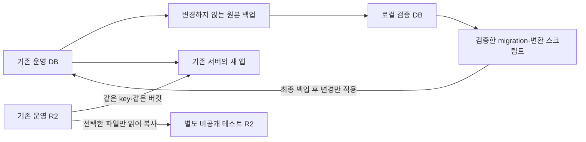

# 기존 운영 서버 업데이트와 DB·R2 전환 계획

작성·실행 상태 갱신: 2026-10-10. **기존 서버 `115.68.207.71` 업데이트로 확정했다.** 실행 세부는 [기존 서버 업데이트 준비](./production-existing-server-update-runbook.md)를 따른다. 실제 완료 범위는 [운영 DB 복원·R2 대조 기록](./production-migration-rehearsal-2026-10-09.md), 미디어 구현은 [개발 정책 2의 22절](./media-asset-database-design.md#22-기존-자료-등록의-로컬-리허설--2026-10-09), 저장 원칙은 [개발 정책 1](./media-r2-folder-structure.md)에 구분한다.

## 1. 권장 방향과 확정할 사항

운영 DB를 로컬에 복원해 실제 데이터로 검증한다. 테스트가 끝나면 **최종 백업 후 기존 운영 DB에 검증된 migration과 운영용 등록 변경만 적용**한다. 로컬 리허설 DB를 운영에 덮어쓰지 않는다. 현재 운영 R2는 유지하고, 쓰기·삭제 테스트는 별도 테스트 R2를 사용한다. 기존 미디어 파일을 다시 업로드하거나 경로를 바꿀 필요는 없다.

앱 업데이트, 새 보관함 공개, 물리 자동 삭제를 독립된 공개 단계로 나눈다. 같은 점검 기간에 앞의 두 단계를 마칠 수는 있지만, 앱 교체 완료가 미디어 기능의 검증 완료를 뜻하지 않는다. 자동 삭제는 별도 관문을 통과할 때까지 비활성으로 유지한다.

현재 확정 범위는 **현재 서버·운영 DB·R2 유지 + 검증된 앱/DB 변경 적용**이다. 새 서버 복원과 DNS 이전은 하지 않는다. 다음 사항은 실제 조회·검증으로 확인했다.

- 기존 운영은 Ubuntu 24.04.4 + Docker Compose + PostgreSQL 16.15/UTC다. 원본 DB를 백업해 같은 PostgreSQL 버전에 로컬 복원했고, 미디어 migration 적용 후 기존 68개 업무 테이블의 3,243행이 동일함을 확인했다.
- 운영 R2 전체 목록은 152개, 8,190,664,580 bytes다. 기존 endpoint의 버킷 경로 때문에 실제 객체에는 버킷명 prefix가 추가돼 있다. 94개 참조는 경로 매핑 후 HEAD가 일치했고, 커뮤니티의 기존 누락 2개는 별도 보류했다.
- 로컬 원본 검증·등록은 59개/약 3.84GB·사용처 66행이며, 3,750건 권한/주소 대조와 전체 재실행 재사용을 통과했다. 운영 DB에는 아직 미디어 테이블이 없다.
- **미확정:** 공개 범위/쓰기 중단 시간, R2 공개 도메인·r2.dev, CORS·lifecycle. 뒤의 두 설정 조회는 403이므로 설정 부재로 판단하지 않는다. 운영 Compose 파일의 기존 수정 사항도 보존해야 한다.

R2 계정까지 옮겨야 한다면 8절의 추가 이관 절차를 적용한다. 현재 운영 버킷을 곧바로 삭제하거나 테스트 버킷으로 교체하는 계획은 아니다.

## 2. 무엇을 어디로 옮기는가



- **앱:** 검증한 소스 revision으로 만든 Docker 이미지로 기존 서버의 앱을 교체한다. 이미지·migration·등록 스크립트의 버전을 함께 기록한다.
- **DB:** 기존 DB·볼륨을 유지하고 추가 변경만 적용한다. 테이블·데이터·제약·함수·트리거·sequence·`_prisma_migrations`를 포함한 전체 백업과 복원 가능성을 확보한다. 사용자/코스/회차 ID와 관계를 보존한다.
- **R2:** 기존 파일은 원래 위치에 둔다. 새 서버가 같은 저장소를 사용한다. 테스트 복사본·테스트 업로드·테스트 DB는 운영 반영 대상이 아니다.
- **운영 설정:** 기존 환경변수·OAuth redirect·HTTPS·리버스 프록시·DNS를 보존하고 검토된 변경만 적용한다. DB 덤프나 Docker 이미지가 이 설정을 대신하지 않는다.

원본 백업, 테스트 DB, 실제 운영 DB를 구분한다. 테스트 DB에서 테스트 행만 지워 운영에 가져오는 방법은 사용하지 않는다. 최초 백업 이후 쓰기가 적었다는 예상에 의존하지 않고 최종 쓰기 중단 후 새 백업을 확보하고 현재 운영 상태에 검증한 스크립트를 적용한다.

## 3. R2 계획

### 3.1 운영 저장소와 테스트 저장소

운영 R2의 `coaching/...`, `courses/...` 및 다른 소비자가 쓰는 기존 경로는 그대로 유지한다. 새 보관함에 등록할 기존 자료는 실제 key를 가진 LEGACY 자산으로 등록한다. 소유자를 확인하지 못한 자료는 UNCLASSIFIED로 보존하며, 현재 담당자나 폴더 이름만으로 개인 소유를 확정하지 않는다.

**2026-10-09 실측:** 아래 기존 `coaching/...`·`courses/...` 예시는 본문이 사용하는 논리 경로다. 실제 운영 object key는 `{버킷명}/coaching/...`·`{버킷명}/courses/...`다. 원본 key를 바꾸지 않는다. endpoint만 정규화하거나, 이전 endpoint에 실제 key를 다시 전달하면 읽기 위치가 달라지므로 **확인된 논리/물리 매핑과 기존 소비자의 읽기 호환을 함께 전환**해야 한다. 조사용 `keyAliases`는 앱의 매핑을 자동 적용하지 않는다. [검증 근거](./production-migration-rehearsal-2026-10-09.md#41-기존-endpoint가-만든-추가-prefix)

신규 자산의 목표 경로는 기존 정책 그대로다.

```text
운영 R2
├── coaching/...                          기존 경로 유지
├── courses/...                           기존 경로 유지
├── 기타 기존 공개/비공개 자료 경로         소비자 조사 후 유지
└── media/
    ├── shared/{assetId}/original.{ext}
    ├── personal/{userId}/{assetId}/original.{ext}
    ├── shared 또는 personal/.../derived/{fileId}/...
    └── staging/{uploadId}/source.{ext}

별도 테스트 R2 (예: online-glia-test, 실제 이름은 설정 시 확정)
└── 선택한 검증 자료 + 테스트에서 새로 생성한 객체
```

테스트 버킷은 기능 검증을 위한 임시 복제 공간이며 운영 백업 버킷이 아니다. 전체 R2를 로컬로 내려받거나 새 서버 디스크에 넣지 않는다. 원본 R2의 독립적인 재해 복구/백업 정책은 별도 결정이며, 이번 서버 이전만으로 해결됐다고 표시하지 않는다.

### 3.2 로컬의 두 검증 방식

**기존 자료 읽기 검증:** 운영 DB 복제본에서 기존 bucket/key/본문 URL을 보존한다. 기존 운영 R2에는 해당 버킷 전용 읽기 권한으로만 접근해 콘텐츠·권한·재생 호환을 확인한다. 이 환경에는 운영 R2 쓰기/삭제 자격 증명을 제공하지 않는다. 로컬 DB의 로그인 세션 등은 변할 수 있으며 이 복제본도 운영으로 되돌리지 않는다.

**업로드·휴지통·삭제 검증:** 별도 로컬 테스트 DB와 비공개 테스트 R2를 쓴다. 복사 도구는 운영 원본을 읽는 자격과 테스트 목적지에 쓰는 자격을 구분하고, 복사할 key 목록·원본/목적지 버킷·용량·내용 해시를 manifest에 기록한다. 이미지·영상·오디오, 작은/큰 파일, 한 파일의 여러 사용처, 사용처 없는 보관 자료, 소유 미확인 자료를 포함한다. 파괴적인 테스트용 원본은 테스트 버킷 안에만 둔다.

현재 코드는 DB의 `MediaFile.bucket`과 실행 환경 버킷이 다르면 재생을 거절하고, 등록된 bucket/key는 DB 트리거가 변경을 막는다. **복원한 DB의 버킷 이름을 일괄 UPDATE하거나 트리거를 끄는 방식은 사용하지 않는다.**

- 운영 DB에 미디어 테이블이 아직 없으면, 선택한 파일을 테스트 버킷에 복사하고 테스트 본문의 URL 매핑을 적용한 뒤 그 위치에서 최초 등록을 검증할 수 있다.
- 이미 등록된 자산이 있으면, 테스트용 import가 테스트 버킷 자산을 새로 만들고 선택한 본문·블록 JSON·사용처를 함께 연결한다. 운영 자산 식별을 조용히 다른 버킷으로 해석하지 않는다. 모든 참조를 다뤘다는 확인 없이 전체 복제 검증 완료로 표시하지 않는다.
- manifest 기반 **테스트 버킷 복사/import**는 아직 구현할 작업이다. 원본을 이동하지 않는 로컬 등록은 별도 도구로 59개·66개 사용처를 검증했다. 이 로컬 도구는 운영 적용 명령이 아니다. 합성 미디어의 개발용 R2 브라우저 검사는 기존 자료 전체의 브라우저 검사를 대신하지 않는다. [실행 지침](./media-r2-live-and-backfill-runbook.md)

이번 원본 검증은 LIST/HEAD/GET만 실행한 코드 경로로 수행했다. 기존 자격 증명 자체의 권한이 읽기 전용으로 축소돼 있음을 증명한 것은 아니다. 상시 읽기 검증 환경은 별도 읽기 전용 토큰으로 구성한다.

R2는 버킷 단위로 읽기 또는 읽기/쓰기 토큰을 구분할 수 있다. 정적 토큰을 경로별 세부 권한이나 PUT 전용 토큰으로 간주하지 않고, 환경별 버킷과 자격 증명으로 격리한다. [R2 인증 문서](https://developers.cloudflare.com/r2/api/tokens/)

### 3.3 신규 개인 자산 공개 전 접근 경로 정리

R2에 `personal/` 경로를 만드는 것만으로 비공개가 되지 않는다. 새 공통/개인 자산의 재생은 앱의 로그인·콘텐츠 권한 프록시를 통과하도록 한다. 공통 자산도 전체 인터넷 공개와 같은 뜻은 아니다.

운영 버킷의 공개 상태는 아직 확인하지 않았다. `r2.dev`와 연결된 모든 공개 도메인을 각각 조사한다. 한 경로만 끄면 다른 경로는 남을 수 있다. [R2 공개 버킷 문서](https://developers.cloudflare.com/r2/buckets/public-buckets/)

1. 현재 공개 URL을 사용하는 코스·코칭뿐 아니라 프로필·상품·커뮤니티 등 모든 소비자를 대조한다.
2. 같은 운영 버킷을 비공개로 전환할 수 있다면, 공개가 필요한 파일은 허용된 앱 제공 경로로 전환하고 비공개 콘텐츠는 권한 프록시로 전환한다. 본문·BlockNote·다른 URL 필드·이전 URL 캐시까지 확인한다.
3. 기능 확인 뒤 직접 공개 경로를 차단하고 필요한 CDN 캐시를 정리한다. 기존 브라우저에 이미 내려간 자료의 회수를 보장하지 않는다. `R2_PUBLIC_BASE_URL`을 비우는 것만으로 기존 본문 URL이나 버킷 설정은 바뀌지 않는다.
4. 모든 직접 경로에서 접근 차단을 확인하기 전에는 새 개인 자료 업로드를 공개하지 않는다.

기존 공개 소비자 때문에 같은 버킷을 비공개로 전환하기 어렵다면 **새 비공개 운영 자산 버킷과 버킷별 읽기 라우팅**을 별도 설계한다. 이는 백업이 아니라 접근 방식 분리다. 현재 앱은 하나의 R2 설정을 사용하므로 설정값 추가만으로 된다고 가정하지 않는다. 이 분기는 정책 1·2와 코드 변경을 먼저 검토해야 하며 기본안에 이미 승인·구현된 것으로 포함하지 않는다.

### 3.4 업로드와 정리 설정

- 브라우저 PUT은 해당 staging key의 presigned URL로 전송한다. 운영 도메인과 테스트 origin의 CORS 설정은 각 버킷에서 분리한다. 실제 클라이언트의 PUT·Content-Type 등 필요한 요청만 허용하고, 만료 URL·응답 유실을 실제 브라우저로 검사한다. presigned URL은 S3 API 도메인을 사용한다. [CORS](https://developers.cloudflare.com/r2/buckets/cors/), [presigned URL](https://developers.cloudflare.com/r2/api/s3/presigned-urls/)
- 새 서버의 ffprobe/ffmpeg, 디스크·메모리 한도, 최대 파일 크기, 검증 동시 실행 수, 처리 시간 제한을 실제 이미지·영상·오디오로 확인한다. 4GB VPS 예제 사양에서 큰 영상 검증이 안전하다고 미리 판단하지 않는다.
- `media/staging/`에만 7일 만료 규칙을 계획한다. 기존 규칙을 먼저 읽고 보존하면서 추가하며 빈 prefix나 버킷 전체 만료로 적용하지 않는다. 이 규칙 역시 실제 삭제 설정이므로 신규 업로드 운영 검증 후 별도로 활성화한다. 수명 규칙은 정확한 시각에 즉시 삭제되는 타이머가 아니다. [R2 수명 규칙](https://developers.cloudflare.com/r2/buckets/object-lifecycles/)
- 최종 `shared/`, `personal/`, 기존 `coaching/`, `courses/`에는 자동 수명 만료를 걸지 않는다. 자산 물리 삭제 worker는 첫 운영 배포에 연결하지 않는다. 테스트용 worker의 운영 버킷 차단도 그대로 유지한다.

## 4. 현재 코드에서 먼저 해결할 배포 항목

다음은 설정만 바꾸면 해결되는 것으로 취급하지 않는다.

1. **새 업로드 운영 제한:** 기본 차단과 명시적인 계정·버킷·실행 환경 검증을 구현했다. `off/admin/all` 공개 범위와 업로드 중지, 기존 편집기 업로드 호환을 격리 DB/Chrome에서 검증했다. 실제 운영 활성화는 공개 설정·CORS·검증 자원 제한 확인 후 진행한다. 삭제 worker의 제한은 해제하지 않는다. [구현된 설정](./production-existing-server-update-runbook.md#31-구현된-공개-설정).
2. **공개 범위 선택:** 현재 편집기는 새 보관함 업로드로 연결돼 있고, 확인한 미디어 경로에는 이전 기능으로 되돌리는 완성된 기능 스위치가 없다. 서버만 먼저 옮기려면 현재 운영의 검증된 revision/image를 사용한다. 새 작업 버전을 쓰려면 UI·직접 API·업로드·정리를 나눈 서버 측 스위치와 호환 경로를 먼저 구현·검증한다. 존재하지 않는 환경변수를 넣었다고 비활성화됐다고 가정하지 않는다.
3. **기존 데이터 등록:** [로컬 등록 도구](./media-r2-live-and-backfill-runbook.md#4-로컬-복제-db-등록-리허설)는 실제 원본 검증·기존 key 보존·본문/사용처 연결·재실행·감사·권한 대조를 통과했다. 최신 운영 데이터에 묶인 운영용 적용 경로와 소유 근거 확인은 남아 있다. 로컬 전용 제한을 해제하거나 누락 객체를 성공 처리하지 않는다.
4. **실제 R2 검증:** 개발용 버킷의 PNG·MP4·MP3·M4A를 실제 Chrome에서 PUT·내용 검증·완료·재생/탐색·Range 검사했고 생성 객체 8개의 부재를 확인했다. 로컬 origin CORS는 통과했지만 운영 도메인·대용량·전체 코덱·Safari/모바일·실패/재시도·late PUT은 추가 검증해야 한다. 정리 worker 검사는 여전히 가짜 저장소 기준이다.
5. **DB 시각:** 앱·미디어 트랜잭션의 UTC 설정은 구현됐고 실제 운영 DB와 로컬 복원 환경도 UTC다. 운영에 새 미디어 상태 행은 아직 없다. 대상 서버의 앱 연결·pooler와 만료/휴지통/lease epoch는 실제 앱 검사에 포함한다. 일괄 9시간 보정하지 않는다.
6. **복사·배포 패키지:** 테스트 객체 복사/등록과 운영 release manifest는 준비할 항목이다. 작업 중인 checkout 전체나 로컬 DB 덤프를 압축해 올리지 않는다. `.dockerignore`에 대조·백업·리허설 산출물 제외를 추가했고 실제 백업은 저장소 밖에 보관했다.
7. **기존 R2 경로:** 계정 endpoint + `R2_LEGACY_KEY_PREFIX` 호환을 구현했고 실제 참조 96개와 등록 자산 59개의 주소·권한을 로컬 검증했다. 앱과 endpoint/prefix 설정을 함께 배포해야 한다. 기존 콘텐츠의 브라우저 E2E·공개 경로·운영용 backfill은 남아 있다. [계약과 검증](./production-migration-rehearsal-2026-10-09.md)

파생본 생성은 후속 개발이다. 초기 보관함 공개가 원본 재생만 제공한다면 지원 형식을 명시하고 실제 브라우저 재생을 통과해야 한다. 재생용 변환이 필요한 자료를 운영에서 제공하려면 파생본 생성·검증·선택 전환까지 먼저 완료한다.

## 5. 실행 단계와 통과 기준

### A. 실제 환경 확인과 원본 확보

- 기존/새 PostgreSQL 버전, extensions, locale/collation, 소유 역할·권한, DB 용량, 현재 앱 revision, migration 적용 목록을 수집한다. 현재 VPS 예제와 같은 구성이라면 로컬도 PostgreSQL 16 컨테이너로 맞춘다. 실제 원본이 더 높은 버전이면 16으로 내리지 않고 목표 버전을 다시 정한다.
- 현재 운영 R2의 계정/버킷/endpoint, 공개 도메인, CORS, lifecycle, 총 객체 수·용량과 소비자 목록을 읽기 전용으로 조사한다. 앱의 하드코딩된 버킷 이름만으로 실제 구성을 확정하지 않는다.
- DB는 전체 custom-format 덤프와 무결성 해시를 보관한다. 복원 로그·도구 버전·시각을 기록하고 실제 복원을 통해 읽을 수 있음을 확인한다. 역할·권한 등 DB 밖 설정은 별도 인수 목록으로 남긴다. [pg_dump](https://www.postgresql.org/docs/16/app-pgdump.html)
- 원본 덤프에는 개인정보·인증 데이터가 들어갈 수 있으므로 Git·Docker context 밖의 접근 제한/암호화 저장소에 둔다. 로컬은 별도 세션 비밀값을 쓰고 실제 발송·결제·외부 webhook·예약 작업을 실행하지 않는 격리 설정을 준비한다.

**통과:** 원본을 수정하지 않은 백업과 실제 복원 성공 기록, DB/R2 조사 범위가 확보됐다. DB 덤프와 R2 목록은 같은 순간의 원자적 스냅샷이 아니므로 관측 시각을 각각 남긴다.

### B. 로컬 전체 복원과 실데이터 검증

1. 새롭고 빈 로컬 DB에 전체 덤프를 복원한다. 복원 오류를 무시하지 않으며 `pg_restore --exit-on-error` 또는 적합한 단일 트랜잭션 복원을 사용한다. DB 이름을 지정해 복원하고 원본 DB 이름으로 생성되는 `--create`의 동작을 혼동하지 않는다. [pg_restore](https://www.postgresql.org/docs/16/app-pgrestore.html)
2. 테이블을 먼저 migration으로 생성한 뒤 `--data-only`로 채우지 않는다. 미디어의 BEFORE 트리거는 READY 자산의 직접 INSERT 등을 거절한다. 전체 복원의 pre-data→data→post-data 순서를 사용하고, 끝난 뒤 FK·CHECK·UNIQUE·지연 트리거·함수 존재와 자산 일관성을 다시 검사한다. 트리거 설치만으로 과거 모든 행이 재검사되는 것은 아니다. [덤프 구성](https://www.postgresql.org/docs/16/app-pgdump.html)
3. 복원된 `_prisma_migrations`와 배포 소스를 비교하고 대기 migration만 `prisma migrate deploy`로 적용한다. `migrate dev`, `db push`, reset, seed를 운영 이관 도구로 쓰지 않는다. Prisma가 표현하지 못하는 부분 인덱스·트리거는 SQL로 별도 확인한다.
4. 로컬 `prisma.config.ts`는 `.env.local`로 URL을 덮어쓸 수 있다. 이관 전용 config와 명시적 대상 확인을 사용해 테스트가 운영 DB에 연결되지 않도록 한다. `npm run build`에는 migration 실행이 포함돼 있으므로 이관 빌드는 검증된 Docker/build:docker 경로로 분리한다.
5. 기존 자료 읽기 검증과 테스트 R2 변경 검증을 3.2절대로 실행한다. 사용자·수강·코스·레슨·코칭 수/관계, 기존 이미지/영상/오디오, 원본 URL, 역할별 접근, 데이터 변환의 반복 실행 결과를 확인한다.
6. 새 보관함을 공개할 경우 등록/backfill을 검증한다. 원본 등록 수·미확인 소유·누락 객체·미해결 참조를 보고서로 남기고, 해결되지 않은 범위를 전체 완료로 표시하지 않는다.

**통과:** 목표 PostgreSQL 버전에서 복원·migration·선택한 공개 범위의 테스트가 통과한다. 기존 228개 DB 검사와 9개 브라우저 검사는 각각 당시 격리 환경의 기록이며 실데이터/목표 환경 테스트를 대체하지 않는다.

### C. 재현 가능한 반영 절차와 배포 이미지 준비

- 운영용 절차는 원본 백업을 깨끗한 별도 로컬 DB에 복원해 재현한다. 검토된 migration·운영용 등록/변환 스크립트만 적용한다. 이 검증 DB 자체나 가짜 계정·테스트 업로드·테스트 버킷 URL을 운영으로 가져오지 않는다.
- 원본 대비 변경 내역을 생성한다. 스키마·의도한 등록/변환 외의 사용자·주문·수강·콘텐츠 변경이 없어야 한다. 미디어 bucket/key/urlKey, 본문/블록/MediaUsage의 일치도 검사한다.
- 검증한 revision의 이미지를 한 번 만들어 식별자와 digest를 기록한다. DB 백업 해시·migration 목록/해시·backfill 버전·R2 관측 시점·기능 공개 범위를 같은 release manifest로 묶는다. 환경변수의 실제 비밀값은 포함하지 않는다.
- 운영 Compose의 기존 변경과 DB 볼륨을 보존한다. [현재 Compose](../docker-compose.prod.yml)는 migrate 뒤 app을 시작하므로 적용/검증 순서를 명시적으로 통제하고 전체 `up --build`로 검증 단계를 생략하지 않는다.

**통과:** 깨끗한 복원본에서 같은 변경을 재현할 수 있고, 배포 이미지·migration·등록 manifest와 되돌리기 자료가 준비된다.

### D. 최종 쓰기 중단과 기존 서버 업데이트

1. 사용자 입력뿐 아니라 관리자 수정, 로그인 세션 변경, webhook, 예약 작업, 업로드 예약/완료 요청까지 쓰기 경로를 정지한다. 이미 실행 중인 DB·R2 작업을 확인한다. 외부 webhook은 누락 없이 재전송/재처리할 수 있는 방식으로 유지보수한다.
2. 1~2일 새 콘텐츠가 없다는 예상만으로 변경 없음으로 판단하지 않는다. 최종 DB 백업과 R2 변경분을 확보하고, 차이가 있으면 C 단계의 검증된 절차에 반영한다. 적용/검증 중에는 쓰기를 재개하지 않는다.
3. 발급된 presigned PUT이나 전송 중 요청은 앱 중단만으로 취소되지 않는다. staging 및 완료 중 작업을 재대조하고 늦게 나타난 객체는 이력과 함께 보류한다. 서버 이전 중 미참조 객체 정리를 시행하지 않는다.
4. 기존 DB에 추가 migration과 검증된 운영용 등록을 적용한다. 이력 불일치나 검증 실패가 있으면 공개하지 않는다. 기존 DB 초기화·로컬 DB 덮어쓰기·중복 SQL 수동 실행은 하지 않는다.
5. UTC·역할 권한·제약·트리거·데이터 수/관계·R2 읽기를 확인하고, 기존 DB 컨테이너와 볼륨을 유지한 채 검증한 앱 이미지와 짝이 맞는 endpoint/prefix를 적용한다.
6. 실제 도메인/HTTPS/프록시/OAuth·세션·기존 콘텐츠와 승인된 업로드 범위를 점검한다. 운영 R2를 대상으로 파괴적 테스트를 수행하지 않는다.
7. 검증 후 쓰기를 재개하고 오류·업로드·사용처 저장을 관찰한다. DNS 이전은 하지 않는다. 세부 인수 기준은 [기존 서버 업데이트 준비](./production-existing-server-update-runbook.md)를 따른다.

**통과:** 기존 서버의 새 앱이 정상 쓰기 주체이며 미디어·권한·주요 업무가 정상이다. 최종 백업부터 서비스 재개까지의 실제 중단 시간을 기록한다.

### E. 새 보관함 공개와 삭제의 후속 단계

새 보관함을 함께 공개하려면 B 단계에서 해당 범위까지 통과하고, 3.3절 접근 경로·4절 운영 업로드 제한을 해결한 이미지를 배포해야 한다. 먼저 관리자의 제한된 실제 업로드로 재생·권한·사용처 저장을 확인하고 일반 사용자에게 공개한다. 이 업로드도 운영 기록으로 남기며 DB를 되돌려 흔적만 지우지 않는다.

자동 삭제는 별도 일정이다. 전체 사용처/backfill·소유 미확인 보호·R2 실장애·반복 sweep·지연 지표·정리 책임자·복구 검증을 통과한 뒤 운영 실행 경로를 따로 만든다. 현재 격리용 [정리 CLI](./media-cleanup-runbook.md)에 운영 DB 주소를 넣는 방식으로 활성화하지 않는다.

## 6. 되돌리기 기준

**서비스 재개 전 실패:** 실패 지점과 DB 변경 상태를 확인한다. 이전 앱과 변경된 DB의 호환이 확인된 범위에서 기존 이미지·Compose·endpoint/prefix를 함께 복원한다. 추가 테이블이 있다는 이유로 DB를 초기화하거나 옛 덤프로 덮어쓰지 않는다.

**서비스 재개 후 실패:** 쓰기를 멈추고 현재 DB 및 신규 R2 객체 목록을 보존한다. 새 데이터가 생긴 뒤 예전 백업을 덮어쓰면 그 변경을 잃는다. 스키마/권한 호환이 확인된 이전 앱으로 복귀하거나 데이터를 보존한 수정 배포·역변환을 수행한다. 이전 앱이 새 자산의 권한·본문·상태를 이해하지 못하면 코드만 되돌릴 수 없다.

이번 이전에서 기존 객체 이동·삭제를 하지 않는 이유는 기존 콘텐츠와 되돌리기 경로를 유지하기 위해서다. DB 복원은 R2 삭제를 복구하지 못한다. 신규 객체는 따로 대조하고 즉시 삭제하지 않는다.

기존 이미지·Compose/설정·원본 백업은 제안상 업데이트 후 7일 이상 보존하되 실제 기간·비용·복구 목표는 적용 전에 확정한다. 갱신된 운영 DB 백업의 복원까지 확인한 뒤 보관 종료를 결정한다.

## 7. 당장 진행할 작업 순서

- [x] 기존 서버·DB 버전, checkout revision·실행 이미지 식별자 확보.
- [x] DB/R2 읽기 전용 조사와 전체 목록·경로 매핑 대조. 미확인 설정과 누락은 실행 기록에 보류.
- [x] PostgreSQL 16.15 로컬 복원 환경, 전용 설정·암호화 백업 보관 위치 준비.
- [x] 원본 DB 백업/전체 복원, 대기 migration 적용과 기존 데이터·실제 제약 검증.
- [x] 기존 R2 논리/물리 key 호환 구현, 154쌍 매핑·실제 참조 96개 로컬 검증.
- [x] 기존 개발용 버킷에서 합성 PNG 1개의 실제 업로드·내용 검증·최종 생성과 테스트 객체 정리.
- [x] 개발용 버킷에서 PNG·MP4·MP3·M4A의 브라우저 업로드/재생/탐색/Range·비허용 사용자 차단과 생성 객체 8개 부재 확인.
- [x] 기존 등록 명세와 원본 59개·사용처 66행의 로컬 등록. 미참조/범위 밖 보존·누락 보류.
- [x] 실제 권한/주소 3,750건·본문/사용처 일치·재실행 전체 재사용·기존 68개 테이블 보존.
- [x] 기존 서버 업데이트로 대상 확정, 서버/DB/R2 유지와 운영 Compose 수정 사항 보존 계획.
- [ ] 이번 공개 범위와 운영 접근·업로드 설정 확정.
- [ ] 기존 콘텐츠의 브라우저 E2E, 미확인 R2 설정·누락 처리.
- [ ] 테스트 버킷·manifest 복사·테스트 import 도구 준비 및 실제 R2 검증.
- [ ] 새 기능 공개 범위에 필요한 운영 업로드 설정·공개 경로 전환·backfill 구현.
- [ ] 깨끗한 복원본에서 운영용 절차 재현, 이미지/release manifest·되돌리기 검증.
- [ ] 중단·최종 백업·기존 DB 변경 적용·앱 교체·서비스 재개.

사용자가 말한 1~2일은 변경이 적은 작업 기회로 활용한다. DB 용량·R2 검증 범위·기존 데이터 문제를 확인하기 전에는 모든 개발과 이전이 그 기간 안에 완료된다고 약속하지 않는다. 서버만 먼저 옮기는 범위라면 테스트 import/새 보관함 공개 작업은 후속 단계로 분리할 수 있다.

## 8. R2 계정·버킷도 옮겨야 할 경우

이 분기는 현재 권장 기본안이 아니다. 필요가 확정되면 다음을 추가한다.

- 기존 객체를 삭제하지 않고 manifest의 정확한 key로 새 버킷에 복사한다. Content-Type 등 제공에 필요한 메타데이터, 용량·해시·실제 재생을 대조한다. ETag만을 파일 내용의 해시로 단정하지 않는다. 진행/실패/재시도 이력을 남기고 기존 객체 덮어쓰기를 금지한다.
- 기존 본문의 공개 도메인·프록시·논리 key와 실제 버킷 매핑을 함께 전환한다. 현재 `MediaFile.bucket/objectKey`는 불변이므로 평범한 UPDATE로 이관할 수 없다. 통제된 이관 migration 또는 논리 저장소와 물리 버킷을 분리하는 모델/라우팅 변경을 설계·검증한다.
- 소스 읽기 자격과 목적지 쓰기 자격을 분리한다. 마지막 쓰기를 중단한 뒤 변경분 복사·누락 대조를 마치고 DB·앱·저장소 설정을 함께 전환한다.
- 같은 bucket 이름이라도 계정/endpoint가 다르면 다른 저장소다. 버킷 이름만으로 동일성이 확인됐다고 판단하지 않는다.
- R2 복사 완료 후에도 원본을 유지한다. DB·파일·도메인·권한 전환 검증과 되돌리기 기간이 끝난 뒤 원본 보존 정책을 별도로 결정한다.
